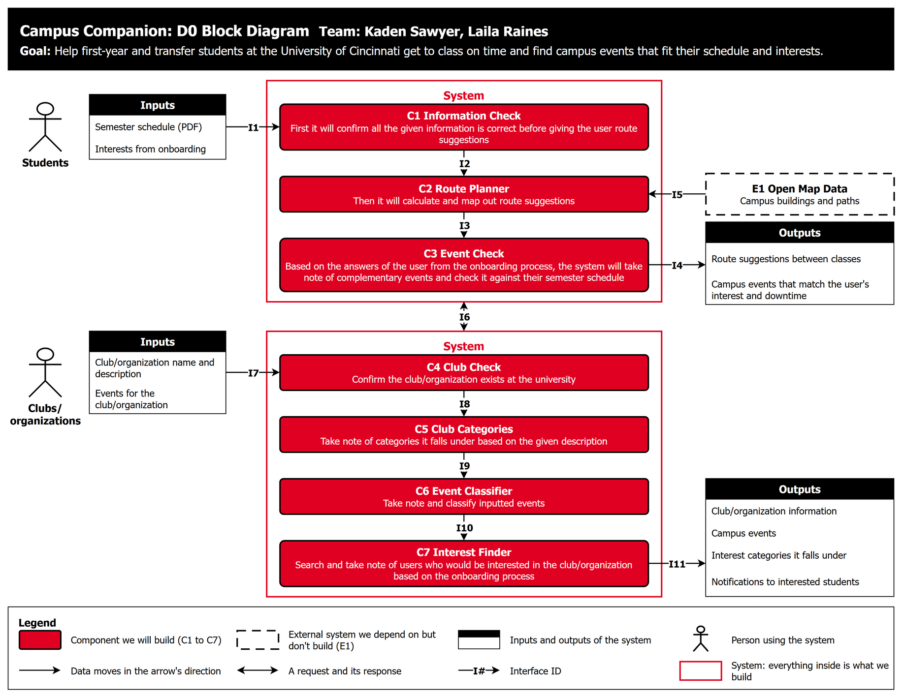
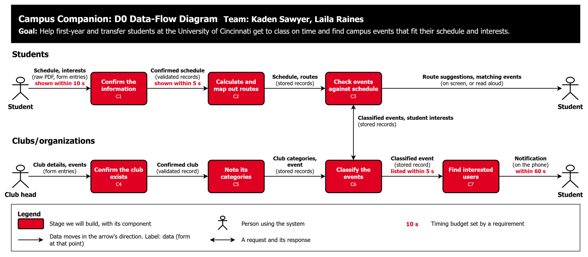

# D0 High-Level Design

**Project:** Campus Companion
**Team:** Kaden Sawyer, Laila Raines

> **Draft.** The owners in Part 3, the decisions in Part 7, and the bracketed items in Part 6 need both team members' agreement. Delete this note before exporting to PDF.

## 1. Title, goal statement, and conventions

**Title:** Campus Companion

**Goal:** Help first-year and transfer students at the University of Cincinnati get to class on time and find campus events that fit their schedule and interests.

**Basic input:** A student's class schedule (PDF) and interests, plus events posted by verified club heads.

**Basic output:** Walking times between classes, event suggestions that fit the student's free time, and event notifications.

**Conventions:** Each diagram has its own legend. Red boxes are components we will build, the dashed box is an external system, black-header tables are the system's inputs and outputs, and figures are people. Each line on the block diagram is an interface, and its label matches a row in Part 4.

## 2. Block diagram (the D0 diagram)



Source: `D0_High_Level_Design.drawio`, page "D0 Block Diagram".

## 3. Component responsibility table

| ID | Component | Responsibility | In | Out | Owner (proposed) | Traces to |
| --- | --- | --- | --- | --- | --- | --- |
| C1 | Information Check | Confirms all the given information is correct before the user gets route suggestions. | I1 | I2 | Kaden | US-01, US-04 |
| C2 | Route Planner | Calculates and maps out route suggestions. | I2, I5 | I3 | Kaden | US-05 |
| C3 | Event Check | Takes note of complementary events from onboarding answers, checking them against the semester schedule. | I3, I6 | I4, I6 | Kaden | US-02, US-04 |
| C4 | Club Check | Confirms the club/organization exists at the university. | I7 | I8 | Laila | US-03 |
| C5 | Club Categories | Takes note of the categories a club falls under, based on its description. | I8 | I9 | Laila | US-03 |
| C6 | Event Classifier | Takes note of and classifies inputted events. | I6, I9 | I6, I10 | Laila | US-02, US-03 |
| C7 | Interest Finder | Searches for users who would be interested, based on onboarding answers. | I10 | I11 | Laila | US-03 |

E1 Open Map Data is an external system we depend on but do not build. It supplies campus buildings and paths to C2 through I5.

## 4. Interface specification table

**Records used in the table:**

- **Course record:** `name`, `professor`, `building`, `room`, `days`: strings; `start`, `end`: times
- **Event record:** `name`, `location`, `description`: strings; `start`, `end`: datetimes
- **Route record:** `from`, `to`: strings; `walkMinutes`: int

| ID | Connection | Inputs | Outputs | Format | Protocol | On error (and who handles it) |
| --- | --- | --- | --- | --- | --- | --- |
| I1 | Student inputs → C1 | `scheduleFile`: PDF, 10 MB max<br>`interests`: list of strings | `courses`: list of course records, shown for review | File upload, form entries | HTTPS | Not a PDF or over 10 MB: rejected with a message, 0 courses saved (AC-01.6). No readable courses: offers manual entry (AC-01.4). **C1 handles.** |
| I2 | C1 → C2 | `courses`: list of course records | `saved`: boolean | JSON | Internal function call | Save fails: nothing partial is kept, and the student is asked to retry. **C1 handles.** |
| I3 | C2 → C3 | `courses`: list of course records<br>`routes`: list of route records | `received`: boolean | JSON | Internal function call | Unknown building: that route is left blank, and the rest continue. **C2 handles.** |
| I4 | C3 → Student outputs | `routes`: list of route records<br>`events`: list of event records | None (shown on screen) | App screens | Mobile app UI | Results cannot load: offers a retry, and events are never shown unchecked. **C3 handles.** |
| I5 | E1 → C2 | `campusArea`: pair of coordinates | `buildings`, `paths`: lists of coordinates | Map data file | HTTPS download, done ahead of time | Download fails: C2 keeps its last good copy. **C2 handles.** |
| I6 | C3 ↔ C6 (between the two System boxes) | `interests`: list of strings | `events`: list of event records | JSON | Internal function call | Data unavailable: offers a retry, and events are never shown unchecked. **C3 handles.** |
| I7 | Club inputs → C4 | `clubName`, `description`: strings<br>`event`: event record | `status`: string | Form entries | HTTPS | Missing field: highlighted, nothing published, 0 notifications (AC-02.3). **C4 handles.** |
| I8 | C4 → C5 | `clubId`, `description`: strings | `categories`: list of strings | JSON | Internal function call | Club not confirmed: stops here and shows "not authorized." **C4 handles.** |
| I9 | C5 → C6 | `clubId`: string<br>`categories`: list of strings<br>`event`: event record | `eventId`: string | JSON | Internal function call | Save fails: event is not listed, and the club head is asked to retry. **C6 handles.** |
| I10 | C6 → C7 | `eventId`: string<br>`categories`: list of strings<br>`interests`: list of strings | `interestedUsers`: list of strings | JSON | Internal function call | No matches: no notification is sent. **C7 handles.** |
| I11 | C7 → Club outputs | `event`: event record<br>`categories`: list of strings<br>`interestedUsers`: list of strings | `notification`: title and body strings | App screens, push message | Mobile app UI, OS push | Phone offline: the student sees the change on next open. **C7 handles.** |

**Example payload (I7, posting an event):**

```json
{
  "clubName": "Chess Club",
  "event": {
    "name": "Fall Blitz Night",
    "start": "2026-11-12T18:00:00-05:00",
    "end": "2026-11-12T20:00:00-05:00",
    "location": "Tangeman University Center 400A",
    "description": "Casual blitz games, all skill levels welcome."
  }
}
```

## 5. Data-flow diagram



Source: `D0_High_Level_Design.drawio`, page "D0 Data-Flow Diagram".

The system has two flows, and they meet between C3 and C6. C3 uses the events that clubs post, and C6 and C7 use the interests that students give.

**Timing budgets:**

| Starts when | Ends when | Budget | Requirement |
| --- | --- | --- | --- |
| A student selects a schedule file | Courses, or a "no courses found" message, appear | 10 s | AC-01.1, AC-01.4 |
| A student confirms their courses | The full schedule appears | 5 s | AC-01.2 |
| A student types three letters of a building name during manual entry (not drawn) | Building suggestions appear | 2 s | AC-01.5 |
| A club head submits an event | The event appears in the event list | 5 s | AC-02.1 |
| A club head submits or cancels an event | Interested students are notified | 60 s | AC-02.1, AC-02.2 |

The 60-second budget can only hold for phones that are online. No requirement sets a budget for route suggestions (US-05) or event suggestions (US-02).

## 6. Architecture pattern and justification

The system combines two patterns from the Week 5 lecture.

| Pattern | What it governs |
| --- | --- |
| Client-server | The system as a whole: students and club heads use client screens that share one server, which runs C1 to C7. |
| Pipeline | The two flows inside the System boxes, where data changes form at each stage. Students: C1 → C2 → C3. Clubs: C4 → C5 → C6 → C7. |

**Justification against the five criteria:**

| Criterion | Why this combination fits |
| --- | --- |
| Fit to the problem | Students and clubs need the same event data, so one shared server fits. Both flows move through fixed stages, which is what a pipeline describes. |
| Team skills | We are two Computer Science majors who share the developer and architect roles (Team Contract). Both memebers have software development experience from Co-ops and personal projects they have worked on.|
| Performance and timing | Our budgets are in seconds (Part 5), so the design needs no real-time techniques. Notifications go out after an event is saved, so posting can finish within 5 seconds while notices have 60. None of these budgets has been measured yet. |
| Scalability | We start with one campus. Adding another means adding its map data and supporting its schedule format. Because the stages talk through defined interfaces, one could move to its own service later. |
| Hardware constraints | We build no custom hardware. Client screens run on students' own phones and browsers, and the stages run on a hosted server, so phones do not do the heavy work. |

**Project constraints:**

- **Privacy (FERPA):** Schedule data is stored only with consent, kept to the minimum needed, and fully deleted when a student removes it. One server holds it, so those rules are enforced in one place.
- **Accessibility (US-04):** Schedule and event screens work with the phone's screen reader, so this stays in the client screens.
- **Map data (Constraints Essay):** We use an open map source rather than copyrighted school maps. E1 feeds C2 ahead of time, so students' class locations are not sent out for routing.
- **Diversity (Constraints Essay):** The interest categories in C5 include identity-based organizations, so students can filter by them.
- **Budget:** We assume little or no spending since we will focus on using open sourced software and free tiers of other platforms when needed.
- **Hosting:** The design needs only one hosted server, which keeps the choice open until D1.

**Patterns we rejected:**

- **Microservices:** Deploying each stage separately is too much work for a two-person, time-boxed team, with no benefit at one campus.
- **Embedded sensor-actuator:** We have no custom hardware, sensors, or actuators to control.

## 7. Decision log

| ID | Decision | Alternatives considered | Why this option won |
| --- | --- | --- | --- |
| D-01 | Load the schedule through PDF upload with a student review step. | Manual entry in the event of file extraction errors. | The review step catches extraction errors before anything is saved. **Cost:** extraction accuracy depends on the PDF layout, so manual entry stays as the fallback. |
| D-02 | Import open map data into C2 ahead of time. | Live third-party routing API; UC's own campus maps. | A live API would send students' class locations to a third party on every lookup and adds usage cost. A local dataset also meets the 2-second budget with no network dependency. **Cost:** open data may miss some campus paths, and the dataset needs refreshing by hand. |
| D-03 | Connect the student and club flows inside one system (I6). | Two separate systems that share nothing. | Students cannot see club events, and clubs cannot reach interested students, unless the flows share data. **Cost:** both flows must agree on the event and interest formats. |
| D-04 | Confirm clubs by manual admin approval, checked against UC's published student-organization list. | Automated check against a UC data feed; open posting with no verification. | UC-02 requires a verified club head, and open posting invites spam and impersonation. An automated check depends on a data feed we do not have. **Cost:** a person must review each request. |
| D-05 | Run event matching on the server. | Matching on the phone. | AC-02.1 requires reaching students within 60 seconds even when the app is closed, so the server has to know who is interested. **Cost:** schedule data lives on our server, so consent and real deletion are required. |
