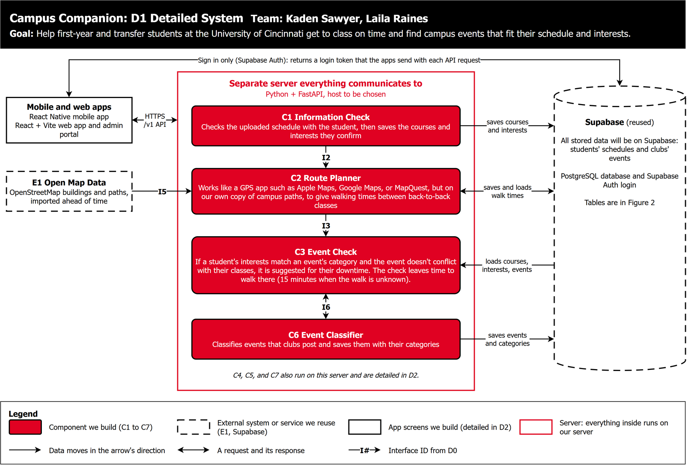
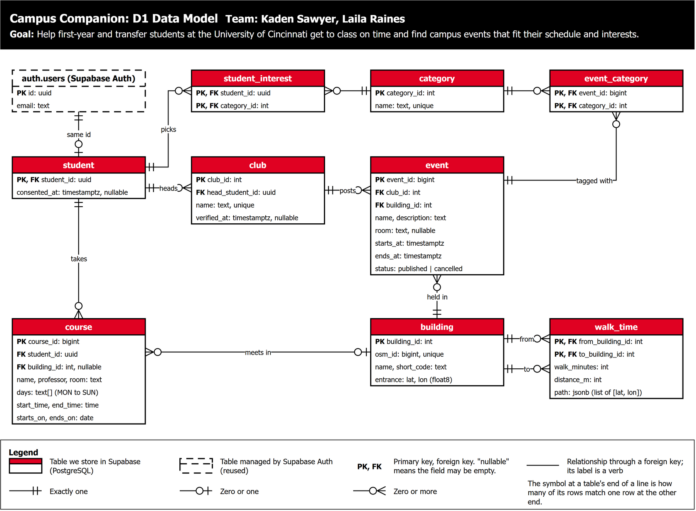

# D1 Detailed Design

**Project:** Campus Companion
**Team:** Kaden Sawyer, Laila Raines

> **Draft.** Bracketed items need both team members' agreement. Delete this note before exporting to PDF.

## 1. Header, scope, and conventions

**Title:** Campus Companion

**Goal:** Help first-year and transfer students at the University of Cincinnati get to class on time and find campus events that fit their schedule and interests.

**Scope:** This document details C1 Information Check and C6 Event Classifier, which hold the data model, and C2 Route Planner and C3 Event Check, whose algorithms break the product if they are slow or wrong; C4 Club Check, C5 Club Categories, and C7 Interest Finder are deferred to D2.



Figure 1 source: `D1_Detailed_System.drawio`, page "D1 Detailed System". It places the four detailed components on our server and shows what each one stores in Supabase.

**Conventions:**

| Figure | Boxes and shapes | Lines | Keys | Cardinality |
| --- | --- | --- | --- | --- |
| Figure 1: Detailed system | Red rounded boxes are components we build (C1 to C7). Dashed shapes are systems or services we reuse (E1, Supabase). The white box is the app screens. Everything inside the red outline runs on our server. | An arrow shows the direction data moves, and a double arrow is a request and its response. I2, I3, I5, and I6 are D0 interface IDs; other labels say what moves. | Not used | Not used |
| Figure 2: Data model | Each red-header table is a PostgreSQL table we store in Supabase. The dashed table is managed by Supabase Auth. Rows list the key attributes as `name: type`. | Each line is a relationship through a foreign key, labeled with a verb. | **PK** marks the primary key and **FK** a foreign key. A primary key made of two fields has PK on both. "nullable" means the field may be empty. | Crow's foot notation at both ends of every line: two bars mean exactly one, a circle and a bar mean zero or one, and a circle and a crow's foot mean zero or more. The symbol at a table's end says how many of that table's rows match one row at the other end. |

## 2. Data model, the D1 diagram



Figure 2 source: `D1_Detailed_System.drawio`, page "D1 Data Model".

C1 writes `student`, `course`, and `student_interest`. C6 writes `event` and `event_category`. C2 writes `building` and `walk_time` each time it imports map data. `club` is filled through C4 and admin approval (D-04), and `category` is a fixed list we enter, both detailed in D2. We shaped the model and the algorithms in Part 3 together: `walk_time` exists so C3 can look up walks quickly, and both courses and events store explicit start and end times so C3 can compare them.

**Relational or simpler store:** We chose a relational model, PostgreSQL through Supabase, over a simpler store such as a document database, for these reasons:

- The data has many-to-many links (students to categories, events to categories), and C3 has to combine them in one query.
- C3 filters events by time window, which an index on `starts_at` serves directly.
- Foreign keys with cascading deletes make deletion real. Deleting a student's account removes their courses and interests in the same transaction, as FERPA requires (D0 Part 6).

**Structural decisions:**

| Decision | Choice | Why |
| --- | --- | --- |
| Building: entity or attribute? | Entity | C2 and C3 both need a building's location and walk times, so courses and events point to one shared row. Picking from a list also stops one building from being typed several ways, and that list powers building suggestions (AC-01.5). |
| Category: entity or a text list? | Entity, joined through `student_interest` and `event_category` | A student picks many categories and a category has many students, and the same holds for events, so both are many-to-many. Join tables can be indexed in both directions, and a fixed list keeps names consistent, including identity-based categories (Constraints Essay). |
| Walk time: entity or computed per request? | Entity, one row per ordered pair of buildings | A walk time belongs to a pair of buildings, not to either one. C2 fills the table once per map import, so C3 looks up each walk in constant time. |
| Student to course: one-to-many or many-to-many? | One-to-many | Each student keeps their own copy of their courses, because we have no UC course catalog to share. Deleting a student deletes exactly their rows. The cost is repeated rows when classmates share a section, which is small. |
| Meeting days: entity or attribute? | Attribute: a `days` list on `course` | UC schedules list one time for all of a course's days. A lab at a different time is entered as a second course. |
| Course times | Local `start_time` and `end_time`, plus `starts_on` and `ends_on` dates | Classes repeat weekly in local time, which stays correct across daylight saving changes. The date range covers half-semester courses and keeps C3 from checking classes that have ended. |
| Event times | `starts_at` and `ends_at` with time zone | Events happen once, so exact times compare directly with "now." |
| Event location | Required `building_id`, optional `room` | C3 needs a walking time to the event, so an event must be in a known building. AC-02.3 already requires a location. |
| Cancelling an event | A `status` field, not deleting the row | UC-02 has to tell interested students about the cancellation, so the row is kept and marked `cancelled`. C3 shows only `published` events. |
| Club to event, and student to club | One-to-many | An event has one hosting club. Each club has one verified head, because admin approval checks one person (D-04), and club heads are students, so `club` points to `student`. Supporting co-heads later would need a join table. |
| Interests | Categories only | A team decision: AC-02.1's "have the club as an interest" means the student picked one of the club's categories. |
| Consent | `consented_at` on `student`, empty until the student agrees | C1 refuses to save courses while it is empty (UC-01 precondition). |

**Indexed fields:**

| Field | Index | Used by | Why |
| --- | --- | --- | --- |
| `course.student_id` | B-tree | C2, C3 | Every request loads one student's courses. Without it, each request scans every student's courses. |
| `event.starts_at`, only rows with `status = 'published'` | Partial B-tree | C3 | C3 asks for published events in a window of up to two weeks. Leaving cancelled events out keeps the index to what C3 can show. |
| `event_category (category_id, event_id)` | B-tree | C3 | Finds events in a student's categories. The primary key `(event_id, category_id)` covers the other direction. |
| `student_interest (category_id)` | B-tree | C7 | Finds which students to notify when an event is posted, within the 60-second budget (AC-02.1). The primary key `(student_id, category_id)` covers C3's lookup of one student's interests. |
| `walk_time (from_building_id, to_building_id)` | Primary key | C2, C3 | Finds one walk in one lookup. C2 also loads the whole table into memory at startup. |
| `building.osm_id`, `category.name`, `club.name` | Unique | C2, C4, C5 | Re-importing map data updates buildings instead of duplicating them, and category and club names cannot repeat. |
| `building.name` | None | C1 (AC-01.5) | With 62 rows, a full scan answers a three-letter search far inside the 2-second budget. We will add a text-search index only if a measurement shows a need. |

## 3. Core algorithms

Both algorithms run on our server. Their complexity depends on these data sizes. We focus on Uptown West, UC's main campus, which has 62 buildings. The other sizes are estimates to check once we import the map data and run a pilot:

| Quantity | Realistic (Uptown West) | 100 times |
| --- | --- | --- |
| Buildings | 62 | 6,200 |
| Walking-path graph | 10,000 points, 25,000 path segments (likely high for one campus) | 1,000,000 points, 2,500,000 segments |
| Students using the app | 1,000 | 100,000 |
| One student's class meetings in two weeks | 30 | 30 (a student's classes don't grow with the user count) |
| Published events in a two-week window | 200 | 20,000 |

### 3.1 C2 walking times between buildings

**What it is and the problem it solves:** US-05 asks how long it takes to walk between back-to-back classes on a campus the student doesn't know yet. As the team's draft says, C2 works like a GPS app such as Apple Maps, Google Maps, or MapQuest: it finds the shortest walking path. The difference is that it searches our own copy of campus paths from OpenStreetMap (E1), so no student's class locations leave our server (D-02). After each map import, C2 runs Dijkstra's shortest-path algorithm once from every building's entrance and stores the walking time and path to every other building in `walk_time`. A request then only looks up a stored row.

**Inputs and outputs:**

- **Import step:** `build_walk_table(graph, buildings, speed_mps=1.2) -> list[WalkRow]`
  - `graph`: the walking network from OSMnx, a `networkx.MultiDiGraph`. Each point has latitude and longitude as `float` degrees, and each path segment has `length` as a `float` in meters.
  - `buildings`: `list[Building]`, each with `building_id: int` and its entrance as `lat: float` and `lon: float`.
  - `speed_mps`: `float`, 1.2 meters per second. This is slower than an average adult walking speed, so estimates err toward leaving early. [Tune after timing a few real walks.]
  - Each `WalkRow` has `from_building_id: int`, `to_building_id: int`, `walk_minutes: int`, `distance_m: int`, and `path: list[tuple[float, float]]`, and is saved to `walk_time`. `walk_minutes` is the distance divided by the speed, rounded up to whole minutes.
- **Request step:** `get_walk(from_building_id: int, to_building_id: int) -> WalkRow | None`, a lookup in memory. `None` means no path exists.

**Expected complexity:** One Dijkstra run with a binary heap costs O((V + E) log V). With V ≈ 10,000 and E ≈ 25,000, that is about 35,000 × 13 ≈ 460,000 steps per building, or about 29 million steps for 62 buildings. Pure-Python NetworkX should finish that in seconds, which we will measure. It runs after each import, never while a student waits.

The table holds 62 × 62 = 3,844 rows, about 6 MB with paths, well inside Supabase's 500 MB free database. Each request is a constant-time lookup.

At 100 times the size (6,200 buildings, a 1-million-point graph), each run takes seconds, so the import would take hours, and the table would reach about 38 million rows. Precomputing every pair would stop working. We would switch to searching one route at a time with A* and caching the results. That difference doesn't matter for us: we serve one campus, and at that size the precomputed table is the simplest correct design.

**Why this approach rather than the alternatives:**

- **Live routing API** (Google, Apple, Mapbox): These are the GPS apps the draft compares C2 to. D0's D-02 rejected them because every lookup sends class locations to a third party and costs money.
- **Straight-line distance times a detour factor:** Instant, but wrong where paths bend around buildings, hills, and fences. An underestimate makes a student late, which is exactly what US-05 exists to prevent.
- **Dijkstra or A\* on every request:** Fast enough for one route, but C3 needs hundreds of walk lookups per request. Precomputing makes each one constant time.
- **Floyd-Warshall over the whole graph:** About 10¹² steps (V³), and we only need pairs of buildings.
- **A self-hosted routing engine** (OSRM, GraphHopper, Valhalla): Built for whole cities. It would be a second service to host and learn, for 62 buildings.

**Edge cases:**

- **Empty input or failed download:** The import stops, and C2 keeps the last good `walk_time` table (D0 I5).
- **Same building:** `walk_minutes` is 0, and the route shows "same building."
- **No path:** This happens when a building's entrance is on a piece of the map that isn't connected, or is more than 100 m from any path. No row is stored, the API marks that leg `no_path`, and the other legs still show (D0 I3).
- **Course with no building:** The leg is marked `unknown_building`, and C3 falls back to 15 minutes.
- **Ties:** Two paths of equal length give the same time, so either is correct. NetworkX returns the same one every run on the same graph.
- **Duplicate buildings:** OpenStreetMap can map one building as several shapes. The import keeps one row per `osm_id`.
- **Rounding:** Times round up, so a short hop between neighboring buildings shows 1 minute, not 0.
- **Not modeled:** Hills, stairs, weather, crowds, and step-free routes. The slower walking speed covers some of this, and step-free routing is a later feature.

### 3.2 C3 event fit check

**What it is and the problem it solves:** US-02 asks for campus events that match a student's interests and don't conflict with their classes. The team's draft rule is that an event is suggested for downtime when its category matches the student's interests and it doesn't conflict with their class schedule, with a 15 to 30 minute buffer before and after. This design keeps that rule but replaces the guessed buffer with the real walk. An event fits a free gap if the student can walk from the previous class to the event, and from the event to the next class, with 5 minutes to spare. When a walk time is missing, it uses 15 minutes, the low end of the draft's guess. If this check is wrong, students are sent to events that make them late for class, or never see events they could have attended.

The steps:

1. Load the student's interests (category IDs). If there are none, return no events with the reason `no_interests`.
2. Ask the database for published events in the window that start after now and share at least one category with the student. This uses the `event.starts_at` and `event_category` indexes.
3. Expand the student's courses into class meetings for each date in the window. A course meets on a date if the date falls between `starts_on` and `ends_on` and its weekday is in `days`. Group the meetings by date and sort each day by start time, in local time for Cincinnati (America/New_York).
4. For each event, take the meetings on its date, or on both dates if it crosses midnight. Reject the event if any meeting overlaps it. Otherwise find the previous meeting (the last one ending before the event starts) and the next meeting (the first one starting after the event ends).
5. The event fits if there is no previous meeting, or the previous meeting's end plus the walk to the event plus 5 minutes is no later than the event's start. The same check applies between the event's end and the next meeting. If either building is unknown or no path exists, 15 minutes replaces the walk plus 5.
6. Rank the events that fit by number of matching categories (most first), then start time (earliest first), then `event_id` (smallest first), and return the first `limit`.

**Inputs and outputs:**

- **Call:** `suggest_events(student_id: UUID, window_start: datetime, window_end: datetime, limit: int = 20) -> Suggestions`
- **Window:** `window_start` and `window_end` are `datetime` values with a time zone, at most 14 days apart.
- **Data it loads:**
  - `courses: list[Course]`, each with `days: frozenset[str]` (MON to SUN), `start_time` and `end_time: time`, `starts_on` and `ends_on: date`, and `building_id: int | None`
  - `interests: set[int]`
  - `events: list[Event]`, each with `event_id: int`, `building_id: int`, `starts_at` and `ends_at: datetime`, and `category_ids: set[int]`
  - `get_walk` from C2
- **Output:** `Suggestions` has `events: list[SuggestedEvent]` and `empty_reason: str | None`. Each `SuggestedEvent` has `event_id: int`, `matched_category_ids: list[int]`, and `walk_minutes_before` and `walk_minutes_after`, both `int | None` in minutes. The API adds names and times (Part 5).
- **Constants:** `MARGIN_MINUTES = 5` and `FALLBACK_MINUTES = 15`. [Tune after testing with students.]

**Expected complexity:** Let M be the class meetings in the window, E the candidate events, and d the most meetings on one day. Building the meetings costs O(M log M), checking costs O(E × d), and ranking costs O(E log E).

At our size (M ≈ 30, E ≈ 200, d ≤ 6), that is about 1,200 checks and a sort of 200 items, well under 10 ms in Python. The database query, at tens of milliseconds, takes longer than the check itself. D0 sets no time budget for event suggestions, so we propose 2 seconds, the same as building suggestions. [Confirm.]

At 100 times the size, M stays near 30 because one student's classes don't grow with the user count, but E grows to about 20,000. The checks (about 120,000) still take under a second in Python. The real cost is moving 20,000 rows out of the database, which would matter. The fix would be to filter more in SQL and return results a page at a time. At our size it doesn't matter.

**Why this approach rather than the alternatives:**

- **A fixed 15 to 30 minute buffer** (the draft's first guess): Simpler, but too strict for an event in the same building as a class and too loose for one across campus. Walk times from C2 handle both cases, and 15 minutes stays as the fallback.
- **Comparing each event with every meeting in the window**, O(E × M): Also fast enough at our size. Grouping by date is just as simple and skips meetings on other days.
- **Learned recommendations** (collaborative filtering): We have no usage data at launch, and it can't explain why an event was suggested. A category match can.
- **Doing all of it in SQL:** Possible, but weekly repeating classes and walk lookups are clearer to unit test in Python, and our testing effort goes to this logic first.

**Edge cases:**

- **No interests:** An empty list with `empty_reason` set to `no_interests`. The app asks the student to pick interests.
- **No matching events:** An empty list with `empty_reason` set to `no_matching_events`.
- **No courses saved yet:** Every matching event fits, and the walk fields are empty.
- **Duplicate events:** C6 rejects a second event with the same club, name, and start time. C3 also returns each event once even when it matches several categories.
- **Ties:** Broken by start time, then `event_id`, so the order is the same on every request.
- **Partial overlap:** An event that overlaps a class by even a minute is not suggested. Partial attendance isn't supported in this version.
- **Past or cancelled events:** Left out by the database query.
- **Holidays and breaks:** Not modeled, so a class that isn't meeting can still hide an event on a break day. We accept this for now.
- **Daylight saving changes:** Handled by Python's `zoneinfo`, with no hand-written offset math.
- **Database unreachable:** The API returns an error and the app offers a retry, so events are never shown unchecked (D0 I4).
- **Walk table not loaded:** Every walk uses the 15-minute fallback, and the server logs a warning.

## 4. Build-versus-reuse decisions

| Piece | Used by | Build or reuse | Library or service | License | Reason |
| --- | --- | --- | --- | --- | --- |
| Sign-in, sessions, password storage | All | Reuse | Supabase Auth | MIT | Authentication should never be hand-rolled, and we already know this one. |
| Database | All | Reuse | Supabase (PostgreSQL) | Apache-2.0 (Supabase), PostgreSQL License | Relational, hosted, and familiar to both of us. |
| Server access to the database and login tokens | All | Reuse | supabase-py | MIT | The official Python client for the same platform. |
| HTTP endpoints, input checks, API docs | All | Reuse | FastAPI, Pydantic, Uvicorn | MIT, MIT, BSD-3-Clause | Typed models enforce Part 5's types and ranges and generate the API description. |
| Reading words and their positions from a schedule PDF | C1 | Reuse | pdfplumber | MIT | Keeps each word's position on the page, so table columns can be rebuilt. |
| Turning UC's schedule layout into course records | C1 | Build | None | None | No library knows UC's layout. This is the part specific to our project. |
| Building name suggestions (AC-01.5) | C1 | Build | A prefix query in PostgreSQL | None | Only 62 names, so a search service would be overkill. |
| Campus buildings and walking paths (E1) | C2 | Reuse | OpenStreetMap data | ODbL 1.0 | Open and free. The app must credit "© OpenStreetMap contributors." |
| Turning map data into a walking graph | C2 | Reuse | OSMnx | MIT | One call turns an area of OpenStreetMap into a walking graph. |
| Shortest paths | C2 | Reuse | NetworkX (Dijkstra) | BSD-3-Clause | A tested implementation, fast enough because it runs ahead of time. |
| Walk table and matching buildings to the nearest path | C2 | Build | None | None | Glue specific to our campus and data model. |
| Event fit check and ranking | C3 | Build | None | None | The core of the product. Nothing off the shelf combines class schedules with walk times. |
| Dates, time zones, sorting | C3 | Reuse | Python standard library (`datetime`, `zoneinfo`, `sorted`) | PSF License | Date parsing and sorting should never be hand-rolled. |
| Event checks and saving | C6 | Build | Rules written as Pydantic models | MIT | The rules come from AC-02.3, and Pydantic does the checking. |

**Checks on each candidate library** (versions and GitHub stars as of 2026-11-05):

| Candidate | Maturity | Licensing | Performance | Fit | Result |
| --- | --- | --- | --- | --- | --- |
| pdfplumber | 0.11.10 (June 2026), 10,900 stars | MIT | Slower than PyMuPDF, but a one- or two-page schedule should take well under the 10-second budget [measure] | Word positions let us rebuild table rows | Chosen |
| PyMuPDF | 2.1 (November 2026), 11,100 stars | AGPL-3.0 or a paid license | Fastest of the three | Good | Rejected: AGPL-3.0 would require us to offer the source of any server that uses it over a network |
| pypdf | 6.21.4 (October 2026), 10,300 stars | BSD-3-Clause | Fast | Gives plain text only and loses column positions | Rejected |
| OSMnx | 2.1.1 (July 2026), 5,900 stars | MIT | Download and graph building take seconds for one campus [measure] | Made for OpenStreetMap walking networks | Chosen |
| NetworkX | 3.7 (September 2026), 17,400 stars | BSD-3-Clause | Pure Python, slower than C libraries, fine for a job that runs ahead of time | Works directly on OSMnx graphs | Chosen |
| FastAPI | 0.162.0 (October 2026), 104,000 stars | MIT | Asynchronous, so slow uploads don't block other requests | Typed contract and generated docs; its version is below 1.0 but it is widely used in production | Chosen |
| Pydantic | 2.14.3 (November 2026), 29,300 stars | MIT | Its core is written in Rust | Input checks | Chosen |
| Uvicorn | 0.54.0 (September 2026), 11,100 stars | BSD-3-Clause | The standard server for FastAPI | Runs FastAPI | Chosen |
| supabase-py | 2.34.0 (November 2026), 2,600 stars | MIT | One HTTPS call per query | The official client | Chosen |
| Supabase Auth | 2.197.0 (September 2026), 2,600 stars | MIT | Managed for us | Clients for React Native and Python | Chosen |

## 5. API contract

**Applies to every endpoint:**

- **Base path:** `/v1`. The apps call it over HTTPS.
- **Login:** Every request sends `Authorization: Bearer <Supabase access token>`.
- **Format:** Bodies are JSON in UTF-8, except the PDF upload.
- **Times:** Date-times are ISO 8601 with an offset, dates are `YYYY-MM-DD`, and clock times are `HH:MM` in campus local time (America/New_York).
- **Units:** Durations are whole minutes and distances are whole meters.
- **Errors:** Every error returns this shape, where `field` is empty when the error isn't about one field:

```json
{ "error": { "code": "invalid_course", "message": "End time must be after start time.", "field": "courses[2].end_time" } }
```

| Status | Code | When it happens | What the app does |
| --- | --- | --- | --- |
| 401 | `not_signed_in` | Token missing or expired | Sends the user to sign in |
| 403 | `consent_required` | A schedule endpoint is called before the student consents | Shows the consent screen |
| 503 | `database_unavailable` | Supabase can't be reached. Nothing partial is saved. | Offers a retry |
| 500 | `internal_error` | Any unexpected failure, which the server logs | Offers a retry |

### POST /v1/schedule/import (C1, I1)

Reads a schedule PDF and returns the courses for review (UC-01). It saves nothing.

| Input | Type | Required | Valid range |
| --- | --- | --- | --- |
| `file` | multipart file | Yes | A PDF of 10 MB (10,485,760 bytes) or less |

**Output (200):** `{ "courses": CourseDraft[], "no_courses_found": boolean }`

Each `CourseDraft` has these fields:

- `name`, `professor`, `room`: string or null
- `building_id`: integer or null, the matched building
- `building_text`: string or null, the building name as printed
- `days`: string[] of `MON` to `SUN`
- `start_time` and `end_time`: `HH:MM` or null
- `starts_on` and `ends_on`: `YYYY-MM-DD` or null
- `missing_fields`: string[] naming the fields the app highlights for the student

When no courses can be read, the response is still 200, with an empty list and `no_courses_found` set to true, and the app offers manual entry (AC-01.4).

| Status | Code | When it happens |
| --- | --- | --- |
| 413 | `file_too_large` | The file is over 10 MB (AC-01.6) |
| 415 | `not_a_pdf` | The file isn't a PDF, such as a JPEG (AC-01.6) |
| 422 | `unreadable_pdf` | The PDF is damaged or password-protected. The app offers manual entry. |
| 504 | `extraction_timeout` | Reading takes over 8 seconds. The app offers manual entry, which keeps AC-01.1's 10-second budget. |

### PUT /v1/schedule/courses (C1, I2)

Saves the courses the student confirmed, replacing their saved courses in one transaction.

| Input | Type | Required | Valid range |
| --- | --- | --- | --- |
| `courses` | CourseIn[] | Yes | 1 to 15 items |
| `courses[].name` | string | Yes | 1 to 100 characters |
| `courses[].professor` | string | No | Up to 100 characters |
| `courses[].building_id` | integer | No | An existing building. If left empty, the course's walks show `unknown_building`. |
| `courses[].room` | string | No | Up to 20 characters |
| `courses[].days` | string[] | Yes | 1 to 7 different values from `MON` to `SUN` |
| `courses[].start_time` | `HH:MM` | Yes | 00:00 to 23:59 |
| `courses[].end_time` | `HH:MM` | Yes | After `start_time` |
| `courses[].starts_on`, `courses[].ends_on` | `YYYY-MM-DD` | Yes | `ends_on` is on or after `starts_on`, and at most 200 days later |

**Output (200):** `{ "saved_count": integer, "courses": Course[] }`, where each `Course` has the `CourseIn` fields plus `course_id: integer`.

| Status | Code | When it happens |
| --- | --- | --- |
| 422 | `invalid_course` | A field is missing or out of range. `field` names it, for example `courses[2].end_time`, so the app can highlight it. |
| 422 | `unknown_building` | `building_id` doesn't match a building |
| 503 | `database_unavailable` | The save failed. Nothing partial is kept, and the student is asked to retry (D0 I2). |

### GET /v1/buildings (C1, AC-01.5)

Suggests buildings while a student types during manual entry.

| Input | Type | Required | Valid range |
| --- | --- | --- | --- |
| `q` | string | Yes | 3 to 50 characters, matched case-insensitively against the start of the name or short code |
| `limit` | integer | No | 1 to 5, default 5 |

**Output (200):** `{ "buildings": [ { "building_id": integer, "name": string, "short_code": string | null } ] }`, with 0 to 5 items. Short-code matches come first, then names from A to Z.

| Status | Code | When it happens |
| --- | --- | --- |
| 422 | `query_too_short` | `q` has fewer than 3 characters. The app waits for more typing. |

### GET /v1/schedule/routes (C2, I3, US-05)

Returns walking times between back-to-back classes on one date.

| Input | Type | Required | Valid range |
| --- | --- | --- | --- |
| `date` | `YYYY-MM-DD` | Yes | Any valid date |

**Output (200):** `{ "date": "YYYY-MM-DD", "legs": Leg[] }`. There is one leg per pair of consecutive classes on that date, and the list is empty with one class or none. Each `Leg` has these fields:

- `from_course_id` and `to_course_id`: integer
- `gap_minutes`: integer, the minutes between the end of one class and the start of the next
- `walk_minutes`: integer or null, in minutes
- `distance_m`: integer or null, in meters
- `path`: an array of `[latitude, longitude]` pairs in degrees, or null
- `status`: one of these values, each of which tells the app what to show:
  - `ok`
  - `tight`: the walk is longer than the gap
  - `same_building`
  - `unknown_building`
  - `no_path`

| Status | Code | When it happens |
| --- | --- | --- |
| 422 | `invalid_date` | `date` isn't a valid `YYYY-MM-DD` date |
| 503 | `routes_unavailable` | The walk table isn't loaded. The app shows the schedule without walking times. |

### GET /v1/events/suggested (C3, I4, US-02)

Returns events that match the student's interests and fit around their classes (Part 3.2).

| Input | Type | Required | Valid range |
| --- | --- | --- | --- |
| `from` | date-time | No | Default is now |
| `to` | date-time | No | After `from` and at most 14 days later. Default is `from` plus 7 days. |
| `limit` | integer | No | 1 to 50, default 20 |

**Output (200):** `{ "window_start": date-time, "window_end": date-time, "events": SuggestedEvent[], "empty_reason": "no_interests" | "no_matching_events" | null }`

Each `SuggestedEvent` has these fields:

- `event_id`: integer
- `name`, `club_name`, `building_name`: string
- `room`: string or null
- `starts_at` and `ends_at`: date-time
- `matched_categories`: string[]
- `walk_minutes_before`: integer or null, the minutes from the previous class that day, or null with no class before it
- `walk_minutes_after`: integer or null, the minutes to the next class that day

| Status | Code | When it happens |
| --- | --- | --- |
| 422 | `invalid_window` | `to` is not after `from`, or the window is longer than 14 days |

### save_event (C6, I9, internal method)

C5 calls this method on the server; it isn't an HTTP endpoint. `save_event(club_id: int, category_ids: list[int], event: EventIn) -> int` returns the new `event_id`.

| Input | Type | Required | Valid range |
| --- | --- | --- | --- |
| `club_id` | int | Yes | A club with `verified_at` set |
| `category_ids` | list[int] | Yes | 1 to 5 existing categories |
| `event.name` | str | Yes | 1 to 100 characters |
| `event.building_id` | int | Yes | An existing building |
| `event.room` | str | No | Up to 20 characters |
| `event.description` | str | Yes | 1 to 2,000 characters |
| `event.starts_at` | datetime with offset | Yes | In the future |
| `event.ends_at` | datetime with offset | Yes | After `starts_at` and at most 24 hours later |

| Error raised | When it happens |
| --- | --- |
| `MissingFieldError(field)` | A required field is empty. Nothing is saved, no notifications go out, and the field is highlighted (AC-02.3). |
| `StartInPastError` | `starts_at` isn't in the future |
| `InvalidTimeRangeError` | `ends_at` isn't after `starts_at`, or is more than 24 hours later |
| `UnknownBuildingError`, `UnknownCategoryError` | An ID doesn't exist |
| `ClubNotVerifiedError` | The club isn't approved. The club head sees "not authorized" (D0 I8). |
| `DuplicateEventError` | The club already has an event with this name and start time |
| `SaveFailedError` | The database write failed. The event isn't listed, and the club head is asked to retry (D0 I9). |

When C4's posting endpoint (detailed in D2) calls `save_event`, these errors become 422, 403, 409, and 503 responses.

### Example

Request:

```http
GET /v1/events/suggested?from=2026-11-09T08:00:00-05:00&to=2026-11-16T08:00:00-05:00&limit=20
Authorization: Bearer <Supabase access token>
```

Response (200):

```json
{
  "window_start": "2026-11-09T08:00:00-05:00",
  "window_end": "2026-11-16T08:00:00-05:00",
  "events": [
    {
      "event_id": 4182,
      "name": "Fall Blitz Night",
      "club_name": "Chess Club",
      "building_name": "Tangeman University Center",
      "room": "400A",
      "starts_at": "2026-11-12T18:00:00-05:00",
      "ends_at": "2026-11-12T20:00:00-05:00",
      "matched_categories": ["Games"],
      "walk_minutes_before": 7,
      "walk_minutes_after": null
    }
  ],
  "empty_reason": null
}
```

**Versioning:** We version the HTTP API in its URL path (`/v1`): adding an endpoint, an optional input, or a response field is not breaking, while removing or renaming a field, changing a type or unit, making an optional input required, or changing an error code is breaking and ships as `/v2`, with `/v1` kept until no supported app version still calls it; internal methods such as `save_event` are not versioned because they deploy with their callers.

## 6. Technology choices with justification

Each paragraph labels the five criteria from class so a teammate can check that all are covered.

**Database: Supabase (PostgreSQL).** *Team skill fit:* Both of us have built projects with Supabase, so we start without a learning curve. *Licensing:* PostgreSQL uses the permissive PostgreSQL License and Supabase is Apache-2.0, so we could move to any PostgreSQL host, or run it ourselves, without rewriting. *Community support:* PostgreSQL has decades of documentation, and Supabase's main repository has about 115,000 GitHub stars and regular releases. *Performance:* Our largest tables hold a few thousand rows (about 5,000 courses and 3,844 walk times), and the indexes in Part 2 keep C3's queries in milliseconds. PostgreSQL's joins and time-range queries fit C3's matching directly. *Cost and hosting:* Supabase hosts it. The free plan includes a 500 MB database, and we estimate using under 100 MB. However, it pauses a project after a week without activity and has no automatic backups. The Pro plan adds daily backups kept for 7 days, which affects FERPA: on Pro, a deleted schedule stays in backups for up to 7 days, and our privacy notice must say so. Every table has row-level security turned on with no policies, so only our server's secret key can read or write data, and the public key inside the apps can't. *Alternative passed over:* Firebase Firestore. It's quick to start with React Native, but it's proprietary and has no joins, so C3's category and time-window matching would need copies of the data kept in sync by hand.

**Authentication: Supabase Auth.** *Team skill fit:* We have used it alongside the Supabase database. *Licensing:* The Supabase Auth server is MIT-licensed. *Community support:* Supabase maintains it (latest release September 2026), with client libraries for React Native and Python. *Performance:* The apps sign in with Supabase directly, and after that the server only checks the token sent with each request. If that check measures slow, the server can verify the token's signature itself without a network call. *Cost and hosting:* It comes with the same Supabase project, and the free plan covers 50,000 monthly active users against our estimated 1,000. *Alternatives passed over:* Writing our own login, which the course says not to hand-roll, and Firebase Authentication, which would add a second vendor next to Supabase.

**Backend: Python with FastAPI.** *Team skill fit:* [We have both used Python in classes and co-ops. Confirm.] *Licensing:* FastAPI and Pydantic are MIT, and Uvicorn is BSD-3-Clause. *Community support:* FastAPI has about 104,000 GitHub stars and a release in October 2026. *Performance:* The heavy work, building the walk table, runs ahead of time, and C3's check takes milliseconds. FastAPI is asynchronous, so a slow PDF upload doesn't hold up other students' requests. Python also has mature libraries for the two hardest parts of D1, pdfplumber for schedule PDFs and OSMnx with NetworkX for walking paths, which is the main reason we chose it. *Cost and hosting:* It is free and open source and runs on any host that supports Python or containers. *Alternative passed over:* Node.js with TypeScript, which would let the mobile app, web app, and server share API types directly. We will get most of that benefit by generating TypeScript types from FastAPI's API description. [Pick the generator tool.]

**Front end: React Native for mobile, React with Vite for the web app and admin portal.** *Team skill fit:* [We both know React. Confirm.] Both apps use the same component model. *Licensing:* All three are MIT. *Community support:* React Native has about 127,000 GitHub stars, React about 252,000, and Vite about 84,000, and all three released in the last month. *Performance:* Our screens are lists, forms, and a route map, with no heavy graphics. React Native uses the phone's own controls, so VoiceOver and TalkBack can read every schedule and event field (US-04). Vite builds the web app into static files that load quickly. *Cost and hosting:* The frameworks are free, and the web app's static files can be served by almost any host. Publishing to the app stores costs $99 a year for Apple and $25 once for Google, which we can avoid during the capstone by demonstrating on test devices and simulators. [Confirm.] *Alternatives passed over:* Flutter for mobile, because Dart is new to us and shares no code with a React web app, and Next.js for the web app, because its server rendering duplicates work our separate server already does.

**Messaging and hardware platform:** Campus Companion uses no hardware platform. Push notifications are sent by C7, so D2 chooses the notification service and justifies it against the same five criteria.

**Hosting for the server: [to be chosen by Kaden and Laila].** Whichever host we choose has to keep the server awake. A sleeping server breaks the 10-second schedule budget (AC-01.1) and risks the 60-second notification budget (AC-02.1). It should also run in the same region as the Supabase project, to keep each database call short. These are the three options we compared (prices as of November 2026):

| Criterion | Render | Railway | Azure for Students (App Service) |
| --- | --- | --- | --- |
| Team skill fit | Deploys from GitHub with a few settings | Deploys from GitHub | More setup through the Azure portal |
| Licensing | A proprietary service, but our server is a standard Python app, so moving hosts needs no code changes | Same as Render | Same as Render |
| Community support | Large documentation set, common for student projects | Good documentation, smaller community | Microsoft's documentation, very large community |
| Performance | The free tier sleeps after 15 minutes idle and takes 30 to 60 seconds to wake. The $7 Starter tier doesn't sleep. | Stays awake while it has credit | Depends on the tier, and the tier we choose must stay on |
| Cost and hosting | Free, but it sleeps; $7 a month to stay awake | $5 trial credit for 30 days, then the Hobby plan at $5 a month including $5 of usage | $100 of credit for 12 months, no credit card needed |

Sources checked on 2026-11-05: [Supabase pricing](https://supabase.com/pricing), [Render free and Starter tiers](https://actualdatabase.com/render-free-vs-starter-pricing/), [Railway pricing](https://www.activepieces.com/blog/railway-pricing-2026-plans-usage-rates-and-costs), [Azure for Students](https://azure.microsoft.com/en-us/free/students), and GitHub and PyPI for library versions, stars, and licenses.
