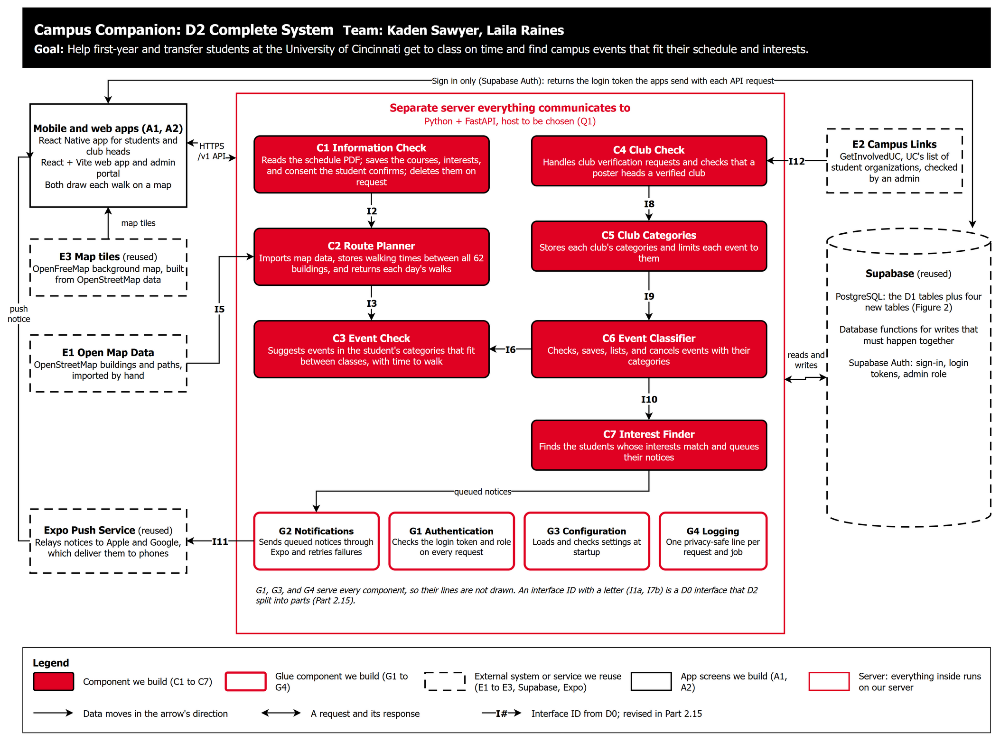
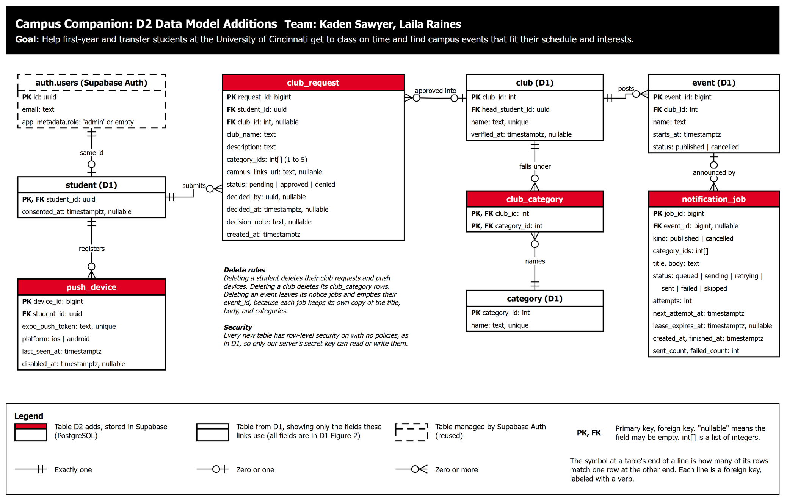
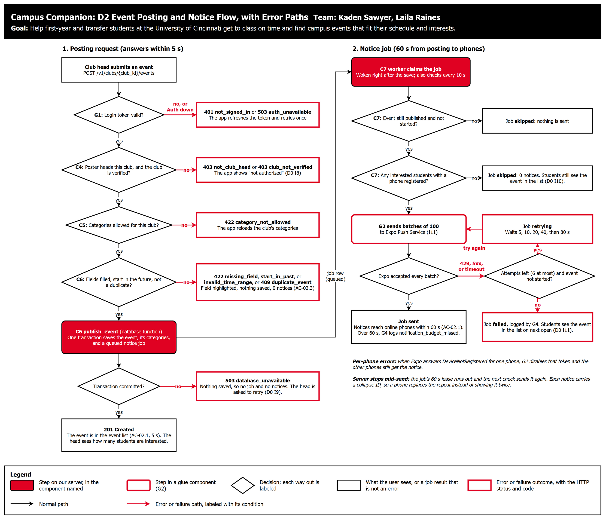
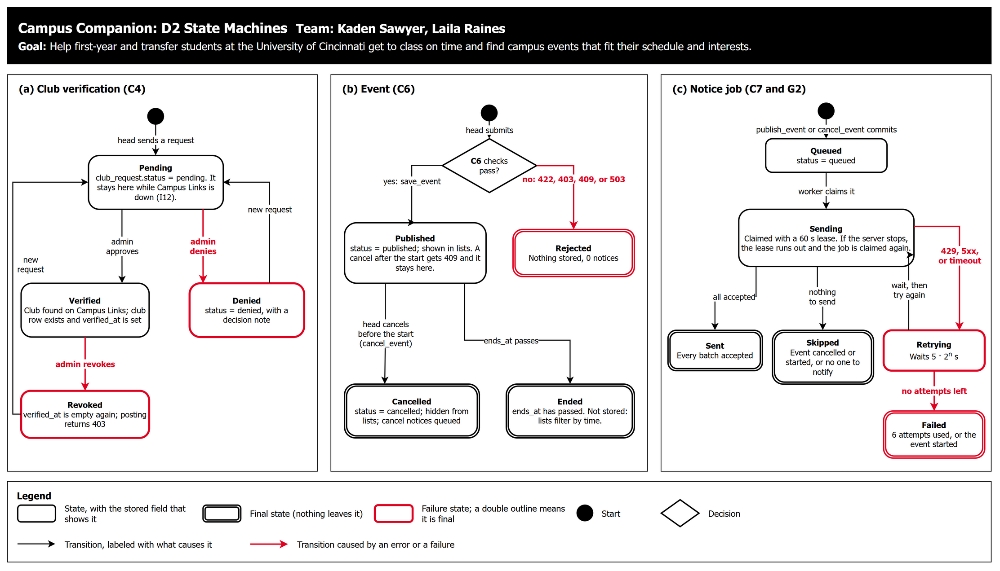

# D2 Detailed Design

**Project:** Campus Companion
**Team:** Kaden Sawyer, Laila Raines

> **Draft.** Bracketed items need both team members' agreement, and Part 6 is filled in after the peer design review. Delete this note before exporting to PDF.

## 1. Header, conventions, and D2 overview

**Title:** Campus Companion

**Goal:** Help first-year and transfer students at the University of Cincinnati get to class on time and find campus events that fit their schedule and interests.

### Overview for a reviewer with no context

**What the system is.** Campus Companion is a mobile app, with a web app and an admin portal, for new students at UC's Uptown West campus. A student uploads their class schedule as a PDF and picks interest categories. The app then draws each walk between back-to-back classes on a campus map, with how long it takes, and suggests campus events in the student's categories that fit between classes. Club heads, once an admin verifies them, post and cancel events, and students with matching interests get a push notification within 60 seconds. One Python server runs every component, and Supabase (PostgreSQL and its login service) stores the data. D0 split the system into seven components, C1 to C7, in two pipelines that meet at the event data: students go through C1 → C2 → C3, and clubs go through C4 → C5 → C6 → C7.

**What D1 covered.** D1 detailed the four components that hold the data or carry the riskiest logic. It gave the data model (D1 Figure 2) for C1 Information Check and C6 Event Classifier, the walking-time algorithm for C2 Route Planner, and the event fit check for C3 Event Check. It also defined their API endpoints, the build-versus-reuse table, and the technology choices.

**What D2 adds.**

- It finishes C4 Club Check, C5 Club Categories, and C7 Interest Finder.
- It fills the gaps left in C1, C2, C3, and C6: how a schedule PDF is read, how map data is imported, and how events are listed and cancelled.
- It gives the same data model, behavior, and interface treatment to four glue components (G1 Authentication, G2 Notifications, G3 Configuration, G4 Logging) and to the apps (A1 mobile, A2 web and admin portal).
- It adds four tables (Figure 2), a flow with every error path for the riskiest feature, posting an event and notifying students (Figure 3), and state machines for the three things with a lifecycle (Figure 4).
- It chooses the push notification service that D1 deferred, and the map library and background map for drawing walks.
- It takes its interest categories from GetInvolvedUC, UC's student-organization site. D0 calls it E2 Campus Links; it was named CampusLINK until 2023.
- It revises the D0 interfaces that grew too many parameters or exposed internals (Part 2.15).
- Parts 3 to 6 hold the edge-case table, the traceability table, the design rationale, and the peer review notes.

### Figures and their conventions

Every figure carries the project title, the team, and the goal statement in its black header, and has its own legend. All four come from `D2_Detailed_Design.drawio`, one page each.

| Figure | Boxes and shapes | Lines | Keys and labels |
| --- | --- | --- | --- |
| Figure 1: Complete system (`D2_Complete_System.png`) | Red rounded boxes are components we build (C1 to C7). White rounded boxes with a red outline are glue components we build (G1 to G4). Dashed shapes are external systems or services we reuse (E1 to E3, Supabase, Expo). The white square box is the apps (A1, A2). Everything inside the red outline runs on our server. | An arrow shows the direction data moves, and a double arrow is a request and its response. | Bold labels are D0 interface IDs; Part 2.15 gives their D2 revisions. |
| Figure 2: Data model additions (`D2_Data_Model.png`) | A red-header table is new in D2. A white-header table comes from D1 and shows only the fields these links use (all of its fields are in D1 Figure 2). The dashed table is managed by Supabase Auth. | Each line is a foreign key, labeled with a verb. | **PK** primary key, **FK** foreign key, "nullable" may be empty, `int[]` is a list of integers. Crow's foot cardinality at both ends, as in D1: two bars mean exactly one, a circle and a bar mean zero or one, and a circle and a crow's foot mean zero or more. |
| Figure 3: Event posting and notice flow with error paths (`D2_Error_Paths.png`) | Red rounded boxes are steps in the named component. The white rounded box with a red outline is a step in a glue component. Diamonds are decisions. Black square boxes are what the user sees, or a job result that is not an error. Boxes with a thick red outline are error or failure outcomes, with the HTTP status and code. | Black arrows are the normal path. Red arrows are error or failure paths, labeled with their condition. | Column 1 is the posting request (5 s budget). Column 2 is the notice job (60 s budget). |
| Figure 4: State machines (`D2_State_Machines.png`) | Rounded boxes are states, each naming the stored field that shows it. A double outline marks a final state. A red outline marks a failure state. The black dot is the start. The diamond is a decision. | Each arrow is a transition labeled with what causes it. Red arrows are transitions caused by an error or failure. | (a) club verification, (b) event, (c) notice job. |

### Known gaps and open questions

These are listed here so reviewers don't have to find them. The open questions need a decision from us:

| ID | Open question | Why it matters | Owner | Due |
| --- | --- | --- | --- | --- |
| Q1 | Which host runs the server (Render, Railway, or Azure for Students, compared in D1 Part 6)? | A host that sleeps makes the first request take 30 to 60 s (EC-69) and puts the 60 s notice budget at risk. | Kaden and Laila | Before the first deployment |
| Q2 | Do we build the mobile app with Expo development builds? | G2 relies on `expo-notifications` and A1's map on MapLibre. Neither works in the Expo Go app; both need a development build. | Kaden | Week 8 |
| Q3 | Who acts as admin after the capstone, and how does an admin confirm that a requester really is a club officer? | During the capstone the two of us approve clubs (D-04). A real launch needs someone at UC, such as Student Activities. | Laila | Week 9 |
| Q4 | Do we set up our own email sender for sign-up and password emails? | Every sign-up now needs a confirmation email to a UC address, and Supabase's built-in sender is meant for testing and allows only a few emails an hour (EC-49). | Kaden | Week 8 |
| Q5 | Do we confirm the priorities in Part 4 and the 2 s budget for event suggestions that D1 proposed? | Both are our proposals, not requirements from the user stories. | Kaden and Laila | Week 8 |

We decided these on 2026-11-11, while drafting D2:

- **iPhone push notifications:** we already have an Apple Developer Program membership, so notices reach iPhones and Android phones at no new cost (2.11).
- **Interest categories:** the 23 organization categories GetInvolvedUC uses (2.7).
- **Maps:** each walk between classes is drawn on a campus map with MapLibre and OpenFreeMap (requirement US-05-M in Part 4, design in 2.14).
- **Sign-up:** limited to confirmed UC email addresses (NFR-09, 2.10).
- **Saving events:** students don't add events to their own schedule. Notices and the event lists are how they find events (Part 4, AC-02.2).
- **Real schedule PDFs:** checked when testing starts (GAP-9).
- **Notice queue and atomic writes:** the `notification_job` table with a worker on the server (R-06), and database functions for writes that touch more than one row (R-05).

These gaps are accepted for this version:

- **GAP-1:** G2 does not read Expo's delivery receipts. A phone that Apple or Google rejects after Expo accepted the notice stays registered until Expo reports it as `DeviceNotRegistered` on a later send.
- **GAP-2:** Events can't be edited. A club head who makes a mistake cancels and posts again, so students get a cancel notice and then a new one.
- **GAP-3:** Students can't save an event to their own schedule. Notices and the event lists show every event, and a cancelled event disappears from both.
- **GAP-4:** Holidays, breaks, hills, stairs, and weather are not modeled (D1 Part 3).
- **GAP-5:** No timing budget has been measured, and the tunable constants (walking speed 1.2 m/s, 5-minute margin, 15-minute fallback, 8 s extraction limit) are untested guesses.
- **GAP-6:** Notices reach only phones that are online and allow notifications (D0 Part 5).
- **GAP-7:** If a student changes interests between a publish notice and a cancellation, they may get a cancel notice for an event they never heard about, or miss one (R-10).
- **GAP-8:** The orientation flow, study spaces, and dining in our README have no user stories and are not designed.
- **GAP-9:** C1's PDF reading rules (2.3) follow the Catalyst schedule layout but haven't been tried on real UC schedules. We will test them on our own schedules, and on volunteers' with their consent, when testing starts.
- **GAP-10:** OpenFreeMap's public map service makes no uptime promise. If it fails, the walk still draws on a plain background (EC-71).

## 2. Finished components, the D2 diagrams



Figure 1 source: `D2_Detailed_Design.drawio`, page "D2 Complete System".

### 2.1 Completeness map

Every component now has a data model, a behavior, and an interface. Where D1 already gave one, this table points to it.

| ID | Component | Data model | Behavior | Interface | Owner (proposed) |
| --- | --- | --- | --- | --- | --- |
| C1 | Information Check | `student`, `course`, `student_interest` (D1 Figure 2) | Step lists for reading a schedule PDF, saving, and deleting (2.3) | D1 Part 5 import, courses, and buildings endpoints, plus 2.3 | Kaden |
| C2 | Route Planner | `building`, `walk_time` (D1 Figure 2) | Dijkstra walk table (D1 3.1), plus import and load steps (2.4) | `get_walk()`, routes endpoint (D1), plus `import_map()` and `load_walk_table()` (2.4) | Kaden |
| C3 | Event Check | No persistent data | Fit check (D1 3.2) | D1 Part 5, with I3 and I6 revised (2.15) | Kaden |
| C4 | Club Check | `club` (D1), `club_request` (Figure 2) | State machine (Figure 4a), posting steps (Figure 3) | Club and admin endpoints (2.6) | Laila |
| C5 | Club Categories | `category` (D1), `club_category` (Figure 2) | Step list (2.7) | Categories endpoint and three methods (2.7) | Laila |
| C6 | Event Classifier | `event`, `event_category` (D1) | State machine (Figure 4b), publish and cancel steps (2.8) | `save_event()` (D1), plus event list, cancel, and I6 (2.8) | Laila |
| C7 | Interest Finder | `notification_job` (Figure 2) | Worker steps (2.9), state machine (Figure 4c) | Methods and job format (2.9) | Laila |
| G1 | Authentication | `auth.users` (Supabase), `student` (D1) | Step list per request (2.10) | Request checks and access table (2.10) | Kaden |
| G2 | Notifications | `push_device` (Figure 2) | Send steps (2.11) | Device endpoints, `send_push()`, message format (2.11) | Laila |
| G3 | Configuration | No persistent data | Load and check at startup (2.12) | `get_settings()` and the settings table (2.12) | Kaden |
| G4 | Logging | No persistent data in our database | One line per request and job (2.13) | `log_event()`, line format, `X-Request-ID` (2.13) | Laila |
| A1, A2 | Mobile app; web app and admin portal | Login session, push token, and cached public map tiles only (2.14) | Screen flows (2.14) | Calls the `/v1` API (2.14) | A1 Kaden, A2 Laila |

### 2.2 Data model additions



Figure 2 source: `D2_Detailed_Design.drawio`, page "D2 Data Model Additions". D2 adds four tables and changes none of D1's.

**Structural decisions:**

| Decision | Choice | Why |
| --- | --- | --- |
| Club request: its own table, or a pending row in `club`? | Its own table, `club_request` | `club.name` is unique. If pending requests were rows in `club`, a fake request for "Chess Club" would hold the name and block the real head. A separate table also keeps denied requests and their notes. A `club` row exists only after an admin approves (R-08). |
| Categories a club asks for: join table or list? | An `int[]` list on `club_request` | They are only a proposal until an admin approves them, at which point they are copied into `club_category`. Nothing searches requests by category. |
| Club to category | Many-to-many through `club_category` | A club has several categories and a category has many clubs. C5 limits each event to its club's categories (2.7). |
| Push device: entity or attribute of `student`? | Entity, `push_device`, with a unique token | A student can have a phone and a tablet. A unique token means one phone belongs to one student at a time, so when someone else signs in on that phone, the token moves to them. |
| Notices: an in-memory queue or a table? | A table, `notification_job` | A job written in the same transaction as its event survives a server restart, so no notice is lost (R-06). |
| What a job stores | Its own copy of the title, body, and `category_ids`, but no list of recipients | The job can still send a cancel notice after its event row is deleted (EC-42). Recipients are found when it runs, so we never store which students were told about which event (R-10). |
| One job per event and kind | Unique `(event_id, kind)` | Each event gets at most one publish notice and one cancel notice, however many times the request is retried. |
| Admin role | `app_metadata.role = 'admin'` in Supabase Auth, not a table | The role arrives inside the login token, so checking it needs no query. Only our server's secret key can change `app_metadata`. |

**Indexed fields:**

| Field | Index | Used by | Why |
| --- | --- | --- | --- |
| `notification_job (next_attempt_at)`, only rows with status `queued` or `retrying` | Partial B-tree | C7 | The worker checks every 10 s for due jobs. The index holds only jobs that are waiting. |
| `push_device (student_id)`, only rows where `disabled_at` is empty | Partial B-tree | C7, G2 | Finds the active phones of the students C7 found. |
| `club_request (student_id, lower(club_name))`, only `pending` rows | Unique partial | C4 | Stops one student from sending the same request twice while it waits (EC-23). |
| `club_request (created_at)`, only `pending` rows | Partial B-tree | C4, A2 | The admin portal lists waiting requests, oldest first. |
| `event (club_id, lower(name), starts_at)` | Unique | C6 | Rejects a duplicate post (D1 Part 3.2, EC-35). D1 described the rule but not its index. |

**Delete rules for every foreign key** (D1 did not state them):

| Foreign key | When the parent row is deleted |
| --- | --- |
| `student.student_id` → `auth.users.id` | Cascade: deleting a login deletes the student row. |
| `course`, `student_interest`, `push_device`, and `club_request` → `student` | Cascade. |
| `club.head_student_id` → `student` | Cascade, but only after C1 has cancelled the club's upcoming events (2.3). |
| `event.club_id` → `club`, and `event_category` → `event` | Cascade. |
| `club_category` → `club` or `category` | Cascade from `club`. Categories are never deleted (2.7). |
| `club_request.club_id` → `club` | Set to empty. |
| `notification_job.event_id` → `event` | Set to empty; the job keeps its copy of the text. |
| `course.building_id`, `event.building_id` → `building` | Restrict: buildings are never deleted, only updated by a re-import (2.4). |

**Sizes:** `push_device` holds about 1,200 rows (about 1.2 phones per student for 1,000 students), `notification_job` about 400 rows per two weeks (two jobs at most for each of 200 events), and `club_request` a few hundred rows. Finished jobs are deleted after 30 days. Every new table has row-level security on with no policies, as in D1, so only our server's secret key can read or write it.

**Writes that must happen together.** D1 promised that saving courses happens "in one transaction." supabase-py sends each call as its own HTTP request to PostgREST, and each request is a separate transaction, so a series of calls can't be one transaction. Every write that touches more than one row runs as a PostgreSQL function that the server calls with supabase-py's `rpc()`. The functions are `replace_courses`, `delete_account_data`, `decide_club_request`, `cancel_club_events`, `publish_event`, `cancel_event`, and `claim_notification_jobs` (R-05).

### 2.3 C1 Information Check

**Data model:** `student`, `course`, and `student_interest`, unchanged from D1.

**Behavior: reading a schedule PDF.** `import_schedule()` runs these steps for POST /v1/schedule/import:

1. **Guard the upload.** Read the file in pieces and stop at 10,485,761 bytes with 413 `file_too_large`. The first five bytes must be `%PDF-`, or the response is 415 `not_a_pdf`. A renamed JPEG fails here, whatever its file name says (AC-01.6).
2. **Open it with a time limit.** `parse_schedule()` runs in a worker thread, and the request waits at most 8 seconds (504 `extraction_timeout`). A damaged or password-protected file, or any error inside pdfplumber, gives 422 `unreadable_pdf`.
3. **Read words and their positions** from the first 5 pages only, and group words whose tops are within 3 points into lines.
4. **Find the columns** from the header words, such as "Days & Times," "Room," "Instructor," and "Start/End Date." These rules follow the Catalyst layout and are checked against real schedules when testing starts (GAP-9).
5. **Split the courses.** A line that starts with a course code, such as `CS 5168` (2 to 5 capital letters, a space, 4 digits, and an optional letter), starts a new course. The lines up to the next code belong to it.
6. **Make one draft per meeting line.** A meeting line has day letters (`Mo`, `Tu`, `We`, `Th`, `Fr`, `Sa`, `Su`) and a time range such as `9:05AM - 10:00AM`. A lecture and a lab become two drafts, as D1 decided. The room column splits into building text and the room number, the last word with a digit in it. The date range fills `starts_on` and `ends_on`. "Staff" as instructor leaves `professor` empty.
7. **Match the building** with `match_building()`. It ignores case and punctuation and looks for an exact match on name or short code, then a prefix that matches exactly one building, and otherwise returns empty. There is no fuzzy matching: a wrong building gives a wrong walk with no warning, while an empty one is highlighted for the student.
8. **Return the drafts.** Empty fields go in `missing_fields`. With no drafts, the response sets `no_courses_found` (AC-01.4). If pages were skipped, it sets `pages_skipped`.

A two-page schedule has about 1,000 words, so grouping them (a sort, O(W log W)) takes milliseconds. pdfplumber's own parsing takes most of the time. [Measure.]

**Behavior: saving.** `replace_courses(student_id, courses)` is one database function. It locks the student's row so two saves run one after the other, checks that `consented_at` is set, deletes the student's courses, inserts the new ones, and returns them. The last save wins, and a schedule is never a mix of two saves.

**Behavior: deleting.** Deleting must really delete (D0 Part 6).

1. Withdrawing consent (DELETE /v1/me/consent) clears `consented_at` and deletes the student's courses and interests in one function call.
2. Deleting the account (DELETE /v1/me) first runs `delete_account_data`. For each club the student heads, it calls `cancel_club_events`, which marks every upcoming event cancelled and queues cancel notices. Then the server deletes the login through Supabase Auth's admin API, and the foreign keys cascade to everything else (2.2).
3. If the second step fails, the app retries. The first step is safe to repeat (EC-10).

**Interface.** D1 Part 5 defines the import, courses, and buildings endpoints. D2 adds one optional response field and five endpoints:

- POST /v1/schedule/import also returns `pages_skipped: boolean`. Adding a field is not a breaking change under D1's versioning rule.
- **GET /v1/me** (any signed-in user): `{ "student_id": uuid, "consented_at": date-time | null, "is_admin": boolean, "category_ids": int[], "clubs": [ { "club_id": int, "name": string, "verified": boolean } ] }`. The first call creates the `student` row. Errors: 401, 503.
- **POST /v1/me/consent:** body `{ "agree": true }`; returns 200 `{ "consented_at": date-time }`. Error: 422 `invalid_request` if `agree` is not `true`. One consent covers both the schedule and interests. [Confirm.]
- **DELETE /v1/me/consent:** 204. Deletes the courses and interests.
- **PUT /v1/me/interests** (consent required): body `{ "category_ids": int[] }`, with 0 to 20 different existing IDs; returns 200 with the saved list. Errors: 403 `consent_required`, 422 `unknown_category`.
- **GET /v1/schedule/courses** (consent required): 200 `{ "courses": Course[] }`, with `Course` as in D1.
- **DELETE /v1/me:** 204. Deletes the account and all of its data. Error: 503, after which the app retries.
- **Internal methods:** `get_courses(student_id: UUID) -> list[Course]` (revised I2) and `get_interests(student_id: UUID) -> set[int]`, both used by C2 and C3. Also `parse_schedule(pdf: bytes, max_pages: int = 5) -> ParseResult`, `match_building(text: str) -> int | None`, and `delete_account(student_id: UUID) -> None`, which raises `DeleteFailedError`.

### 2.4 C2 Route Planner

**Data model:** `building` and `walk_time` (D1), plus a checked-in file, `uptown_west_buildings.csv`. It lists the 62 buildings with `osm_id`, `name`, `short_code`, and an optional entrance latitude and longitude, because OpenStreetMap has no UC short codes and its building outlines don't mark entrances.

**Behavior: importing map data** (run by hand, as D-02 says):

1. A team member runs `python -m server.c2.import_map`.
2. OSMnx downloads the walking network and building outlines for the Uptown West bounding box.
3. Buildings are matched to the CSV by `osm_id`, keeping one row per `osm_id`. Names and short codes come from the CSV. The entrance comes from the CSV, or else from the middle of the building's outline.
4. Each entrance snaps to the nearest walking-graph point. Entrances more than 100 m from a path are reported.
5. `build_walk_table()` runs (D1 3.1).
6. **Sanity check:** if fewer than 90% of building pairs have a path, the import stops before writing anything and keeps the last good table (EC-16).
7. Buildings are upserted, and `walk_time` is replaced in one database call.
8. The command prints an `ImportReport`.

**Behavior: loading the walk table.** The server loads `walk_time` into memory at startup and again every 6 hours (WALK_RELOAD_HOURS). A new table is built next to the old one and swapped in with one assignment, so a request never sees half a table (EC-13). If loading fails at startup, the server tries again every 60 seconds. Meanwhile, routes return 503 `routes_unavailable` and C3 uses its 15-minute fallback (EC-14). To use a new import right away, restart the server.

**Interface:**

- `import_map(area: BoundingBox, buildings_csv: Path) -> ImportReport`, where `BoundingBox` has `north`, `south`, `east`, and `west` in degrees (revised I5). `ImportReport` has `buildings: int`, `rows: int`, `unreachable_pairs: int`, `written: bool`, and `reason: str | None`.
- `load_walk_table() -> int` returns the number of rows loaded and raises `WalkTableUnavailable`.
- `get_walk(from_building_id: int, to_building_id: int) -> WalkRow | None` (D1, now the whole of I3).
- GET /v1/schedule/routes is unchanged from D1. It reads courses through `C1.get_courses()` (I2).

### 2.5 C3 Event Check

**Data model:** No persistent data. C3 reads courses and interests through C1, candidate events through C6, and walks through C2.

**Behavior:** The fit check and ranking in D1 Part 3.2, unchanged.

**Interface:** `suggest_events()` and GET /v1/events/suggested are unchanged from D1. Two of its inputs are now narrower interfaces (2.15). C3 calls `C6.list_candidate_events()` instead of querying C6's tables itself (I6), and `C2.get_walk()` instead of receiving every route (I3).

### 2.6 C4 Club Check

**Data model:** `club` (D1) and `club_request` (Figure 2). A club exists only once approved. `verified_at` is set at approval and emptied again if an admin revokes the club.



Figure 3 source: `D2_Detailed_Design.drawio`, page "D2 Event Posting Error Paths". Posting an event is our riskiest flow: it crosses four components, a database transaction, and an outside service, all within the 60 s budget. Column 1 is C4's posting endpoint, and column 2 is C7's notice job (2.9).

**Behavior: posting an event** (Figure 3). POST /v1/clubs/{club_id}/events runs these checks in order. The first one that fails ends the request with the error shown in Figure 3:

1. G1 checks the login token.
2. C4's `require_club_head()` checks that the club exists, that the user heads it, and that it is verified.
3. C5's `resolve_event_categories()` picks the categories.
4. C6's `save_event()` checks the fields, then calls `publish_event`.
5. The response is 201 with `interested_count` from `C7.count_interested()`.



Figure 4 source: `D2_Detailed_Design.drawio`, page "D2 State Machines". Part (a) is C4's lifecycle, part (b) is C6's, and part (c) is C7's.

**Behavior: verifying a club** (Figure 4a, D-04):

1. A student sends a request with the club's name, description, 1 to 5 categories, and optionally the address of its GetInvolvedUC page (`campus_links_url`). The request is Pending.
2. The admin portal (A2) lists Pending requests, oldest first. It flags requests waiting more than 7 days, and requests that name a club that already has a head.
3. The admin finds the club on GetInvolvedUC (E2 Campus Links, I12). They check that the requester is listed as an officer, or confirm through the club's listed email [agree on the check, Q3]. They also check that the requested categories match the ones on the club's GetInvolvedUC page. While the site is down, the request stays Pending.
4. **Approve:** `decide_club_request` runs in one transaction.
   - If no club has that name, it creates the club with the requester as head and `verified_at` set to now, and copies the categories into `club_category`. The admin may change the categories first.
   - If the club exists, it makes the requester the head and sets `verified_at`. This covers a new head each year, and a club coming back after a revoke.
   - It marks the request approved and records who decided it and when.
5. **Deny:** the request becomes Denied with a note the requester can see. They may send a new request.
6. **Revoke:** `verified_at` is emptied, and `cancel_club_events` cancels the club's upcoming events and queues cancel notices. A wrongly approved club's events may be fake, so they don't stay up.

**Interface** (all bodies JSON, errors in D1's error shape):

| Endpoint | Who may call | Input | Output (success) | Errors |
| --- | --- | --- | --- | --- |
| POST /v1/clubs/requests | Any signed-in user | `club_name`: string, 3 to 100 characters; `description`: string, 20 to 2,000; `category_ids`: int[], 1 to 5; `campus_links_url`: https URL up to 300 characters, optional | 201 `{ "request_id": int, "status": "pending" }` | 422 `invalid_request`, `unknown_category`, `too_many_categories`; 409 `request_pending` |
| GET /v1/clubs/mine | Any signed-in user | None | 200 `{ "requests": [ { request_id, club_name, status, decision_note, created_at } ], "clubs": [ { club_id, name, verified, category_ids } ] }` | 401, 503 |
| GET /v1/admin/club-requests | Admin | `status`: pending, approved, or denied; default pending | 200 `{ "requests": [ { request_id, club_name, description, category_ids, campus_links_url, requester_email, existing_club: { club_id, head_email } or null, created_at } ] }` | 403 `not_admin` |
| POST /v1/admin/club-requests/{request_id}/decision | Admin | `decision`: approve or deny; `category_ids`: int[], 1 to 5, optional on approve; `note`: string up to 500, required on deny | 200 `{ "request_id": int, "status": string, "club_id": int or null }` | 403 `not_admin`; 404 `not_found`; 409 `already_decided`; 422 `note_required` |
| POST /v1/admin/clubs/{club_id}/revoke | Admin | `note`: string, 1 to 500 | 200 `{ "club_id": int, "verified": false, "cancelled_events": int }` | 403 `not_admin`; 404 `not_found` |
| POST /v1/clubs/{club_id}/events | Verified head of that club | `name`, `building_id`, `room`, `description`, `starts_at`, `ends_at` as in `save_event` (D1); `category_ids`: int[], 0 to 5, optional | 201 `{ "event_id": int, "status": "published", "category_ids": int[], "interested_count": int }` | 403 `not_club_head`, `club_not_verified`; 404 `club_not_found`; 422 `missing_field`, `start_in_past`, `invalid_time_range`, `unknown_building`, `category_not_allowed`, `too_many_categories`; 409 `duplicate_event`; 503 `database_unavailable` |
| GET /v1/clubs/{club_id}/events | Head of that club | `include_past`: boolean, default false | 200 `{ "events": [ { event_id, name, starts_at, status, interested_count } ] }` | 403 `not_club_head` |
| POST /v1/events/{event_id}/cancel | Head of the event's club | `confirm`: true | 200 `{ "event_id": int, "status": "cancelled", "interested_count": int }` | 403 `not_club_head`; 404 `not_found`; 409 `already_cancelled`, `event_already_started`; 422 `invalid_request` without `confirm` |

Internal method: `require_club_head(user: AuthUser, club_id: int) -> Club`, which raises `ClubNotFoundError`, `NotClubHeadError`, or `ClubNotVerifiedError`. These become 404, 403, and 403.

**Example (I7b, posting an event):**

```http
POST /v1/clubs/12/events
Authorization: Bearer <Supabase access token>
Content-Type: application/json

{ "name": "Fall Blitz Night", "building_id": 31, "room": "400A",
  "description": "Casual blitz games, all skill levels welcome.",
  "starts_at": "2026-11-12T18:00:00-05:00", "ends_at": "2026-11-12T20:00:00-05:00",
  "category_ids": [] }
```

```json
{ "event_id": 4182, "status": "published", "category_ids": [7], "interested_count": 64 }
```

The same request without `building_id` returns 422:

```json
{ "error": { "code": "missing_field", "message": "Location is required.", "field": "event.building_id", "request_id": "5b0d1c9e-0f4e-4d61-9a77-6f0f3f2b8c11" } }
```

### 2.7 C5 Club Categories

**Data model:** `category` (D1) and `club_category` (Figure 2). The categories are the 23 that GetInvolvedUC uses for student organizations, so a club picks the same categories it already has there. A database migration copies them, trimming stray spaces and keeping GetInvolvedUC's spelling. Categories are never deleted, only renamed, so old events and interests keep their meaning. If GetInvolvedUC changes its list, we add the new categories with another migration.

The 23 categories, as listed on GetInvolvedUC on 2026-11-11:

- Academic
- Academic Intercollegiate Competition
- CEAS Organizations
- Club Sports
- Cohort Program
- College of Allied Health Sciences Student Organizations
- Community Service
- Creative & Performing Arts
- Cultural
- DAAP Student Organizations
- Esports
- Governance & Tribunals
- Graduate
- Health & Wellness
- Honorary
- Lindner Student Organizations
- Living Learning Community
- Political & Activitist (GetInvolvedUC's spelling)
- Professional
- Recreation
- Religious
- Special Interest
- UCBA Affinity Group

"Cultural" and "Religious" are the identity-based categories (Constraints Essay). GetInvolvedUC has no separate category for groups such as LGBTQ+ organizations; they appear under whichever categories they chose there.

**Behavior** (R-09):

1. **At request time,** `validate_categories()` checks the head's picks: 1 to 5 different IDs that all exist.
2. **At approval,** the admin compares the picks with the club's GetInvolvedUC page and its description, and keeps or changes them. `set_club_categories()` then replaces the club's `club_category` rows. D0 said C5 works "based on its description." In D2 a person checks the categories, instead of software guessing from the description.
3. **At posting,** `resolve_event_categories()` decides each event's categories. With none requested, the event gets all of the club's categories. Otherwise, the requested categories must be some of the club's own. A club therefore can't tag an event with unrelated categories to reach more students, and "students who have the club as an interest" (AC-02.1) means exactly the students with one of the club's categories.
4. **At startup,** the category list is loaded into memory and served from there, since it changes only with a migration (EC-32).

**Interface:**

- **GET /v1/categories** (any signed-in user): 200 `{ "categories": [ { "category_id": int, "name": string } ] }`, sorted by name.
- `validate_categories(ids: list[int]) -> list[int]` raises `UnknownCategoryError` or `TooManyCategoriesError`.
- `set_club_categories(club_id: int, ids: list[int]) -> None`.
- `resolve_event_categories(club_id: int, requested: list[int]) -> list[int]` raises `CategoryNotAllowedError` or `TooManyCategoriesError` (revised I8).

### 2.8 C6 Event Classifier

**Data model:** `event` and `event_category` (D1), plus the unique index against duplicate posts (2.2).

**Behavior:** Figure 3 shows where C6's checks sit in the posting flow, and Figure 4b gives the event's lifecycle. "Ended" is not stored; lists simply filter by time.

- **`publish_event`** is one database function. It locks the club row and checks `verified_at` again (EC-25). Then it inserts the event, its `event_category` rows, and a `notification_job` with kind `published`, status `queued`, and the title and body from `C7.build_notice()`. It returns the new `event_id`. A duplicate fails on the unique index, so a double tap creates neither a second event nor a second job (EC-35).
- **`cancel_event`** locks the event row. If the status is already `cancelled`, it returns 409 `already_cancelled`. If `starts_at` is not after the database clock's now, it returns 409 `event_already_started`. Otherwise it sets the status to `cancelled` and queues a job with kind `cancelled`, both in the same transaction.
- **`cancel_club_events`** runs `cancel_event` for every upcoming event of one club (used by revoke and account deletion).

**Interface:**

- `save_event(club_id: int, category_ids: list[int], event: EventIn) -> int` is unchanged from D1. Its database step is now `publish_event`.
- `cancel_event(event_id: int) -> None` raises `EventNotFoundError`, `AlreadyCancelledError`, `EventStartedError`, or `SaveFailedError`. These become 404, 409, 409, and 503.
- `list_candidate_events(category_ids: set[int], window_start: datetime, window_end: datetime) -> list[Event]`, with `Event` as in D1 3.2 (revised I6). It returns published events in the window that share at least one category.
- **GET /v1/events** (any signed-in user), the event list that AC-02.1 and the UC-02 postcondition refer to:

  | Input | Type | Required | Valid range |
  | --- | --- | --- | --- |
  | `from` | date-time | No | Default is now |
  | `to` | date-time | No | After `from` and at most 14 days later. Default is `from` plus 7 days. |
  | `category_id` | integer | No | An existing category, so students can filter by identity-based categories (Constraints Essay) |
  | `limit` | integer | No | 1 to 100, default 50 |
  | `offset` | integer | No | 0 to 10,000, default 0 |

  Output (200): `{ "events": EventSummary[], "next_offset": int | null }`, sorted by start time and then `event_id`. Only published events are listed. Each `EventSummary` has `event_id`, `name`, `club_name`, `building_name`, `room` (string or null), `starts_at`, `ends_at`, and `categories` (a list of strings). Errors: 422 `invalid_window`, 422 `unknown_category`.
- **GET /v1/events/{event_id}:** 200 with the `EventSummary` fields plus `description`, `building_id`, and `status`. It returns cancelled events too, so the app can show "cancelled" (EC-19). Error: 404 `not_found`.

### 2.9 C7 Interest Finder

**Data model:** `notification_job` (Figure 2). C7 reads `student_interest` (D1, using its `category_id` index) and `push_device`.

**Behavior: the worker loop.** It runs as a background task inside the server process.

1. Wait until `publish_event` or `cancel_event` wakes it, or 10 seconds pass (NOTIFY_POLL_SECONDS).
2. Call `claim_notification_jobs(5)`. It takes up to 5 jobs that are `queued` or `retrying` with `next_attempt_at` reached, or `sending` with an expired lease. It locks them with `FOR UPDATE SKIP LOCKED`, so two server instances never take the same job. Then it sets them to `sending` with a 60 s lease and adds one to `attempts`.
3. Run `process_job()` on each job, then go back to step 1. Once a day, delete finished jobs older than 30 days.

**Behavior: `process_job()`** (Figure 3, column 2; Figure 4c):

1. **Check that the notice still matters.**
   - For a `published` job: if the event is gone, cancelled, or already started, mark the job `skipped`.
   - For a `cancelled` job: if the event's publish job was skipped, mark this one `skipped` too, because no one was told about the event (EC-40).
2. **Find recipients.** `find_recipient_tokens(category_ids)` is one query. It finds the different students with at least one of the categories in `student_interest`, joins their active rows in `push_device`, and returns the tokens. If there are none, mark the job `skipped` (D0 I10).
3. **Build one Expo message per token** from the job's own title and body. Each message carries `data: { event_id, kind }` and a collapse ID and Android tag of `event-<id>-<kind>`.
4. **Send** them with `G2.send_push()` in batches of 100.
5. **Record the result.**
   - If every batch was accepted, mark the job `sent` and record the counts.
   - If a batch fails with 429, a 5xx error, or a timeout, and attempts remain (6 at most) and the event hasn't started, mark the job `retrying` with `next_attempt_at` = now + 5 × 2^(attempts − 1) seconds, that is 5, 10, 20, 40, then 80 s. Otherwise mark it `failed`.
   - A retry sends every batch again, and the collapse ID makes a repeat replace the first copy on the phone.
6. **Log** the job's result and its latency, the time from `created_at` to `finished_at`, through G4. Over 60 s, also log `notification_budget_missed`.

**Expected complexity:** Let S be the students with a matching interest and T their active tokens. The query uses two indexes and costs O(S + T), and sending takes ⌈T / 100⌉ HTTPS calls, at most 5 a second. At our size (1,000 students, about 1.2 phones each), an event in one popular category reaches about 300 students, which is 4 calls and about 1 to 2 seconds. The worst case, every student, is 1,200 tokens: 12 calls and about 3 seconds. Even after three retries (5 + 10 + 20 s), a notice lands inside 60 s. At 100 times the size (120,000 tokens), Expo's limit of 600 notices per second alone means at least 200 seconds, which misses the budget. We would then switch to topic messaging in Firebase Cloud Messaging, one send per category. That doesn't matter at one campus.

**Interface:**

- `build_notice(event: EventIn, club_name: str, building_name: str, kind: Literal["published", "cancelled"]) -> NoticeText` returns `title` and `body`. Published: "New event: {name}" and "{club} · {day and time, such as Thu Nov 12, 6:00 PM} · {building} {room}". Cancelled: "Cancelled: {name}" and "{club} cancelled this event on {day and time}." A body is at most 250 characters, far under Expo's 4 KiB limit.
- `count_interested(category_ids: set[int]) -> int` counts students with a matching interest, with or without a phone (UC-02's count).
- `find_recipient_tokens(category_ids: set[int]) -> list[str]`.
- `wake() -> None` and `process_job(job: NotificationJob) -> JobOutcome`, where `JobOutcome` is sent, retrying, failed, or skipped.
- The job row (revised I10) is Figure 2's `notification_job`. Students' interests never leave C7.

### 2.10 G1 Authentication

**Data model:** Supabase Auth's `auth.users` holds emails and password hashes, which we never see, and `app_metadata.role`. We set that role by hand in the Supabase dashboard for admins (the two of us during the capstone). G1 stores nothing else. Sign-up is limited to UC email addresses, and Supabase Auth's "Confirm email" setting is on. An account therefore works only after its owner opens the confirmation email sent to their UC inbox. C1 creates the `student` row on the first GET /v1/me.

**Behavior, for every request except sign-in:**

1. Read `Authorization: Bearer <token>`. If it is missing, return 401 `not_signed_in`.
2. Check the token with Supabase Auth (`auth.get_user`), as D1 Part 6 decided. If Supabase Auth can't be reached, return 503 `auth_unavailable` (EC-48). A bad or expired token gets 401 (EC-44, EC-46).
3. Check that the email is confirmed (`email_confirmed_at` is set) and ends in one of `ALLOWED_EMAIL_DOMAINS` (2.12). Otherwise, return 403 `uc_email_required` (EC-50). The apps check the domain before sign-up too, but the server's check is the one that counts.
4. Build `AuthUser(user_id, email, is_admin)`. `is_admin` is true when `app_metadata.role` is `admin`.
5. Run the route's access check from the table below. Every database query then uses `AuthUser.user_id`, never an ID from the request body.

The apps sign up, sign in, refresh tokens, and reset passwords directly with Supabase Auth through `supabase-js`. Tokens last 1 hour, and the client refreshes them on its own.

**Interface:** FastAPI dependencies.

- `current_user(authorization: str) -> AuthUser` raises 401 `not_signed_in`, 403 `uc_email_required`, or 503 `auth_unavailable`.
- `require_consent(user: AuthUser) -> AuthUser` raises 403 `consent_required`.
- `require_admin(user: AuthUser) -> AuthUser` raises 403 `not_admin`.
- `require_club_head(user, club_id)` belongs to C4 (2.6).

| Who may call | Endpoints |
| --- | --- |
| Any signed-in user with a confirmed UC email | GET /v1/me, POST and DELETE /v1/me/consent, DELETE /v1/me, GET /v1/categories, GET /v1/buildings, GET /v1/events, GET /v1/events/{event_id}, POST and DELETE /v1/devices, POST /v1/clubs/requests, GET /v1/clubs/mine |
| A signed-in student who has consented | PUT /v1/me/interests, POST /v1/schedule/import, GET and PUT /v1/schedule/courses, GET /v1/schedule/routes, GET /v1/events/suggested |
| The verified head of that club | POST /v1/clubs/{club_id}/events. GET /v1/clubs/{club_id}/events and POST /v1/events/{event_id}/cancel need the head only, so a revoked club's head can still see and cancel its events. |
| Admin | Every /v1/admin/... endpoint |

### 2.11 G2 Notifications

**Data model:** `push_device` (Figure 2).

**Behavior:**

- **Register.** After the student allows notifications, the app gets its Expo push token and calls POST /v1/devices on every start. The server upserts by token, moves the token to this student if another student had it, clears `disabled_at`, and sets `last_seen_at`.
- **Unregister.** On sign-out, the app calls DELETE /v1/devices/{token}, so the next person on that phone doesn't get the previous student's notices.
- **`send_push(messages)`:**
  1. Split the messages into batches of 100.
  2. POST each batch to `https://exp.host/--/api/v2/push/send` with a 10 s timeout, at most 5 batches a second (EC-51).
  3. For each ticket in the answer, count `ok`. On `DeviceNotRegistered`, set `disabled_at` on that token. Count any other per-phone error as failed.
  4. If the HTTP answer is 429 or a 5xx error, or there is no answer in time, raise `RetryableSendError`, and C7 moves the job to `retrying`.
- Receipts are not checked in this version (GAP-1).

**Interface:**

- **POST /v1/devices:** `expo_push_token`, a string of up to 200 characters matching `ExponentPushToken[...]`, and `platform`, either `ios` or `android`. Returns 204. Error: 422 `invalid_push_token`.
- **DELETE /v1/devices/{expo_push_token}:** 204. It only removes the caller's own token, and an unknown token also returns 204, so the call is safe to repeat.
- `send_push(messages: list[PushMessage]) -> list[PushTicket]` raises `RetryableSendError`. `PushTicket` has `token`, `status` (ok or error), and `error` (string or null).
- **Message format (revised I11),** one per phone, holding only public event information and nothing from the student's schedule:

```json
{ "to": "ExponentPushToken[xxxxxxxxxxxxxxxxxxxxxx]",
  "title": "New event: Fall Blitz Night",
  "body": "Chess Club · Thu Nov 12, 6:00 PM · Tangeman University Center 400A",
  "data": { "event_id": 4182, "kind": "published" },
  "collapseId": "event-4182-published", "tag": "event-4182-published",
  "priority": "high", "sound": "default" }
```

**Messaging service choice: Expo Push Service.** D1 Part 6 left this choice to D2. *Team skill fit:* [Neither of us has sent push notifications before. Confirm.] Expo's service takes one JSON request for both iPhone and Android, and we call it with httpx, which already comes with supabase-py, so the server gains no new library. The app uses `expo-notifications` (Q2). *Licensing:* `expo-notifications` is MIT. The push service itself is proprietary but free. Only `send_push()` and the app's token registration touch it, so moving to Firebase Cloud Messaging later would change one module. *Community support:* Expo is the framework React Native's own documentation recommends for new apps, and its push documentation covers our exact error cases (`DeviceNotRegistered`, 429 retries). *Performance:* Up to 100 notices per request and 600 per second per project. Our worst case is 1,200 notices in about 3 seconds (2.9). *Cost and hosting:* Expo charges nothing for sending notices. Android delivery needs a free Firebase project for credentials. iPhone delivery needs Apple's push service, which requires the $99-a-year Apple Developer Program. We already have a membership, so it adds no new cost. On privacy, Expo says it keeps notice contents only in memory until it hands them to Apple or Google, and our notices hold only public event information. *Alternatives passed over:* Firebase Cloud Messaging used directly is free, but it needs the Firebase SDK in the app, a Google service account on our server, and separate Apple setup in a second console. OneSignal adds a third vendor that stores our device records. Sending no push at all, only showing events when the app opens, would fail AC-02.1 for anyone not using the app at that moment (D-05).

Sources checked on 2026-11-11: [Expo: sending notifications](https://docs.expo.dev/push-notifications/sending-notifications/) and [Expo push FAQ](https://docs.expo.dev/push-notifications/faq/).

### 2.12 G3 Configuration

**Data model:** No persistent data. Settings come from environment variables on the host, with the defaults below kept in code. Secrets live only on the host, never in the repository.

**Behavior:**

1. At startup, `load_settings()` reads the environment into a Pydantic model and checks every type and range.
2. If any setting is missing or out of range, the server logs `config_invalid` with the setting's name, never its value, and exits. The host then shows a failed deploy instead of a server running with a wrong value (EC-57, EC-59).
3. Settings are read once. A change takes effect when the host restarts the server, so no request sees a mix of old and new values (EC-58).

**Interface:** `get_settings() -> Settings` (cached), and `load_settings() -> Settings`, which raises `ConfigError`.

| Setting | Type | Default | Valid range | Secret | Used by |
| --- | --- | --- | --- | --- | --- |
| `SUPABASE_URL` | URL | None, required | https URL | No | All |
| `SUPABASE_SECRET_KEY` | string | None, required | Not empty | Yes | All |
| `EXPO_ACCESS_TOKEN` | string | Empty | Optional; only needed if we turn on Expo's push security setting | Yes | G2 |
| `ALLOWED_ORIGINS` | list of URLs | None, required | The web app's address | No | A2 (browser cross-origin rule, CORS) |
| `ALLOWED_EMAIL_DOMAINS` | list of domains | `mail.uc.edu`, `uc.edu` | Not empty | No | G1 (UC-only sign-up). [Confirm that `uc.edu` staff addresses should be allowed, for example a future admin.] |
| `CAMPUS_TZ` | time zone | America/New_York | A valid zone | No | C1, C3, C7 |
| `WALK_SPEED_MPS` | float | 1.2 | 0.8 to 2.0 | No | C2 |
| `MARGIN_MINUTES` | int | 5 | 0 to 30 | No | C3 |
| `FALLBACK_MINUTES` | int | 15 | 5 to 60 | No | C3 |
| `MAX_UPLOAD_BYTES` | int | 10,485,760 | Fixed by AC-01.6 | No | C1 |
| `MAX_PDF_PAGES` | int | 5 | 1 to 20 | No | C1 |
| `EXTRACTION_TIMEOUT_S` | float | 8 | 1 to 9, so a reply still comes inside AC-01.1's 10 s | No | C1 |
| `WALK_RELOAD_HOURS` | int | 6 | 1 to 48 | No | C2 |
| `NOTIFY_POLL_SECONDS` | int | 10 | 2 to 30 | No | C7 |
| `NOTIFY_MAX_ATTEMPTS` | int | 6 | 1 to 10 | No | C7 |
| `LOG_LEVEL` | string | INFO | DEBUG, INFO, WARNING, or ERROR | No | G4 |

### 2.13 G4 Logging

**Data model:** No persistent data in our database. Each log line is one JSON object written to standard output, and the host's log viewer keeps the lines. [Retention depends on the host, Q1.]

**Behavior:**

1. A middleware gives every request a `request_id` and returns it in the `X-Request-ID` header and in every error body. That is an added field, so not a breaking change.
2. When a request ends, the middleware writes one line with the time, `request_id`, method, route pattern (for example `/v1/events/{event_id}`), status, `duration_ms`, and `user_id`. Errors add the exception type and stack trace, never the request body.
3. C7 writes one line per finished job (2.9). C2 writes one line per walk-table load.
4. **Privacy:** only allow-listed fields are written. Anything else, such as a course name, building, email, push token, or PDF text, is replaced with `"[redacted]"`. A unit test fails if a schedule field reaches a log line (EC-63). After an account is deleted, its `user_id` in old lines no longer links to a person.
5. Each field is cut to 500 characters and each line to 8 KB. Logging never raises an error into the request (EC-61, EC-64).

**Interface:** `log_event(name: str, level: str = "info", **fields) -> None`. Example line:

```json
{ "ts": "2026-11-12T17:58:03.412-05:00", "level": "info", "event": "request", "request_id": "5b0d1c9e-0f4e-4d61-9a77-6f0f3f2b8c11", "method": "POST", "route": "/v1/clubs/{club_id}/events", "status": 201, "duration_ms": 184, "user_id": "8a1f3c52-6b0e-4f7d-9d2a-1c3e5f7a9b0d" }
```

### 2.14 A1 Mobile app and A2 Web app and admin portal

**Data model:** Almost no persistent data. The apps keep the Supabase login session, through `supabase-js` (the phone's secure storage on A1, browser storage on A2), and A1 keeps its push token. Schedules, interests, and events are held in memory for the session and loaded again from the API. Nothing about a student's schedule is written to the device (NFR-02). The map library caches background map tiles of campus, which are public data.

**Behavior (screen flows):**

1. **First run:** sign in, or sign up with a UC email address (the app refuses other domains) and open the confirmation email. Then the consent screen, which explains what is stored and that deletion is real (POST /v1/me/consent). Then pick interests (GET /v1/categories, PUT /v1/me/interests), then allow notifications (POST /v1/devices).
2. **Schedule import:**
   - Pick a PDF. The app checks the size before uploading (EC-65).
   - The screen moves from Uploading to Reviewing, where highlighted fields can be edited.
   - **Confirm** goes to Saving (PUT) and then the schedule.
   - **Cancel** drops the drafts and saves 0 courses (AC-01.3).
   - Any import error, or no courses found, leads to manual entry with building suggestions (GET /v1/buildings).
3. **Today:** each day's classes with the walking legs between them (GET /v1/schedule/routes).
   - Tapping a leg draws its `path` as a line on a campus map, with markers at both buildings and the walk time and distance above the map (US-05-M).
   - A leg with `no_path` or `unknown_building` shows its status in place of a line.
   - The map shows "© OpenStreetMap contributors" (NFR-05).
4. **Events:** "For you" (GET /v1/events/suggested) and "All events" with a category filter (GET /v1/events). Tapping a push notice opens the event's detail screen (GET /v1/events/{event_id}).
5. **Club head:** request verification, see its status (GET /v1/clubs/mine), post an event, and list events with interested counts and a Cancel button that asks for confirmation.
6. **Settings:** withdraw consent, delete the account (each with a confirmation), and sign out (DELETE /v1/devices/{token}).
7. **Admin portal (A2 only):** Pending requests, oldest first, with flags (2.6), then approve with categories, deny with a note, or revoke.

**Accessibility (US-04):** every field has an accessibility label and is read in visual order. Times are read as words, for example "6 PM to 8 PM." No information is shown only by color or icon, and buttons are at least 44 by 44 points. The map is never the only place a walk appears: each leg's start, end, minutes, and distance are text above it, and the map is labeled, for example "Map of the walk from Baldwin Hall to Swift Hall." The API returns full names (`building_name`, `club_name`), not codes, so a screen reader has something meaningful to say. We check every schedule and event screen with VoiceOver and TalkBack before each demo. [Confirm.]

**Interface:** The apps call only the `/v1` API and Supabase Auth's sign-in, plus the background map. Shared TypeScript types are generated from FastAPI's API description (D1 Part 6). Each error code from D1 Part 5 and D2 maps to one screen behavior, such as highlighting a field, sending the user to sign in, or showing a retry banner. A1 draws maps with MapLibre React Native and A2 with MapLibre GL JS. Both load OpenFreeMap's background map (E3) straight from OpenFreeMap. Those requests carry only the map area on screen, never class data, and the walk line itself comes from our server's `path`.

**Map choice: MapLibre with OpenFreeMap tiles.** We chose this pair because both are free, need no API key, and are built from OpenStreetMap, the same open data C2 routes on (Constraints Essay, D-02). The walk line therefore sits on the same paths it was computed from. MapLibre React Native is MIT-licensed and MapLibre GL JS is BSD-3-Clause. MapLibre React Native needs a development build, as push notifications already do (Q2). OpenFreeMap's public service makes no uptime promise, so the walk line still draws without it (EC-71, GAP-10). *Alternatives passed over:* react-native-maps draws on Apple's and Google's maps. Android needs a Google Maps key, and the background map would not be open data. OpenStreetMap's own tile servers ask apps not to rely on them under their tile usage policy.

### 2.15 Revised D0 interfaces

D0 is unchanged. This table records how each D0 interface works in D2. A letter after an ID means D2 split that interface.

| D0 ID | D0 definition (short) | Problem | D2 interface |
| --- | --- | --- | --- |
| I1 | Student inputs → C1: `scheduleFile` and `interests` | One interface carried two unrelated inputs. | **I1a** POST /v1/schedule/import with PUT /v1/schedule/courses (D1). **I1b** PUT /v1/me/interests (2.3). |
| I2 | C1 → C2: `courses` in, `saved: boolean` out | C2 has no use for a receipt; it needs one student's courses. | `C1.get_courses(student_id) -> list[Course]` |
| I3 | C2 → C3: all `courses` and all `routes` in, `received: boolean` out | Too many parameters: it passed C3 data C3 reloads anyway. | `C2.get_walk(from_building_id, to_building_id) -> WalkRow \| None` (D1 3.1) |
| I4 | C3 → student outputs: `routes` and `events` together | It hid that routes come from C2 and that there is a plain event list. | **I4a** GET /v1/schedule/routes (C2). **I4b** GET /v1/events/suggested (C3). **I4c** GET /v1/events and GET /v1/events/{event_id} (C6). |
| I5 | E1 → C2: `campusArea`, a pair of coordinates | Too vague to build from. | `import_map(area: BoundingBox, buildings_csv)` (2.4) |
| I6 | C3 ↔ C6: `interests` as strings in, `events` out | Strings instead of IDs, and C3 read C6's tables directly, which exposed their layout. | `C6.list_candidate_events(category_ids, window_start, window_end) -> list[Event]` (2.8) |
| I7 | Club inputs → C4: `clubName`, `description`, and `event` together | Registering a club and posting an event are separate actions, and a club name is a weak identifier. | **I7a** POST /v1/clubs/requests. **I7b** POST /v1/clubs/{club_id}/events. **I7c** POST /v1/events/{event_id}/cancel (2.6). |
| I8 | C4 → C5: `clubId`, `description` in, `categories` out | The description matters only at approval, not at every post. | `C5.resolve_event_categories(club_id, requested) -> list[int]` (2.7) |
| I9 | C5 → C6: `clubId` string, `categories` strings, event | D1 already changed it to integer IDs. | `C6.save_event(club_id: int, category_ids: list[int], event: EventIn) -> int` (D1) |
| I10 | C6 → C7: `eventId`, `categories`, and every student's `interests` | C6 would have to gather all students' interests, which C6 should never see. | A `notification_job` row written in the same transaction as the event. C7 finds interested students itself (2.9). |
| I11 | C7 → outputs: event, categories, and `interestedUsers` | Sending a list of interested students out of the server exposes who is interested in what. | One Expo message per phone, with event information only (2.11). |
| I12 | E2 → C4: `clubName` in, `listed: boolean` out | None. It stays a check an admin does by hand. | Recorded as the decision on `club_request` (2.6). |
| I13 (new) | A1 → G2 | D0 had no way for the server to learn a phone's push token. | POST and DELETE /v1/devices (2.11) |
| I14 (new) | E3 → A1, A2 | D0 drew no background map. | Map tiles over HTTPS, loaded by the map library from OpenFreeMap (2.14) |

### 2.16 Additions to build versus reuse

| Piece | Used by | Build or reuse | Library or service | License | Reason |
| --- | --- | --- | --- | --- | --- |
| Push delivery to iPhone and Android | G2, A1 | Reuse | Expo Push Service with `expo-notifications` | MIT (library); the service is free | One API for both platforms (2.11). |
| HTTP calls to Expo | G2 | Reuse | httpx, already installed with supabase-py | BSD-3-Clause | No new dependency. |
| Notice queue and worker | C7 | Build | A table, a PostgreSQL function with `FOR UPDATE SKIP LOCKED`, and an asyncio task | PostgreSQL License | About 100 lines. A queue service such as Redis would be a second thing to host (R-06). |
| Writes that must happen together | C1, C4, C6, C7 | Build | PostgreSQL functions called through supabase-py `rpc()` | PostgreSQL License | The only way to get one transaction through supabase-py (R-05). |
| Settings | G3 | Reuse | Pydantic, already chosen in D1 | MIT | Typed ranges with clear errors. |
| Log lines | G4 | Reuse and build | Python `logging` with a short JSON formatter | PSF License | The standard library is enough for one line per request. |
| Admin role | G1 | Reuse | Supabase Auth `app_metadata` | MIT | No extra table or query. |
| Drawing the walk on a map | A1, A2 | Reuse | MapLibre React Native (A1), MapLibre GL JS (A2) | MIT, BSD-3-Clause | Free and keyless, and works with open map data (2.14). |
| Background map (E3) | A1, A2 | Reuse | OpenFreeMap public tiles, built from OpenStreetMap | Free service; map data under ODbL 1.0 | Same open data as C2's routing; requires the OpenStreetMap credit. |

## 3. Edge cases and error handling

Each component has at least one row in each of the four categories from class: **Boundary** (boundary values), **Timing** (timing and concurrency), **Bad input** (bad or missing input), and **External** (external dependencies). Each decision starts with the behavior chosen:

- **Retry:** try again on a schedule.
- **Degrade:** keep working with less.
- **Fall back:** use an alternative.
- **Surface error:** tell the user, or us, with a specific code.

Figure 3 draws the error paths of the riskiest flow, and Figure 4 shows the failure states.

| ID | Component | Category | Edge case | Design decision | Handler | Recoverable? |
| --- | --- | --- | --- | --- | --- | --- |
| EC-01 | C1 | Boundary | A PDF of exactly 10 MB (10,485,760 bytes), or one byte more | **Surface error:** exactly 10 MB is accepted. The guard counts bytes as they arrive and stops at 10,485,761 with 413 `file_too_large`; 0 courses are saved (AC-01.6). | `import_schedule()` upload guard | Yes: the student picks a smaller file |
| EC-02 | C1 | Boundary | A PDF longer than 5 pages, such as a whole transcript | **Degrade:** read only the first 5 pages, which bounds the work, and set `pages_skipped` so the app says some pages were not read. | `parse_schedule()` | Yes |
| EC-03 | C1 | Timing | Reading the PDF takes more than 8 s | **Fall back:** stop waiting, return 504 `extraction_timeout`, and offer manual entry, which keeps AC-01.1's 10 s budget. | `import_schedule()` | Yes |
| EC-04 | C1 | Timing | The student withdraws consent on one device while another device is reviewing an import | **Surface error:** `replace_courses` checks consent inside its transaction and returns 403 `consent_required`; nothing is saved. | `replace_courses`, `require_consent` | Yes: consent again |
| EC-05 | C1 | Bad input | A JPEG renamed to .pdf | **Surface error:** the first bytes must be `%PDF-`, or the response is 415 `not_a_pdf`; 0 courses saved (AC-01.6). | upload guard | Yes |
| EC-06 | C1 | Bad input | A damaged or password-protected PDF, or an unexpected pdfplumber error | **Fall back:** 422 `unreadable_pdf`, and the app offers manual entry. The error type is logged, never the file's text. | `parse_schedule()` | Yes |
| EC-07 | C1 | Bad input | Building text matches nothing ("TBA," "Online," a typo), or a course has no meeting time | **Degrade:** `building_id` is empty and listed in `missing_fields`, so the app highlights it. An online course can be removed because it needs no walk. Saved without a building, its legs show `unknown_building`. | `match_building()` | Yes |
| EC-08 | C1 | Bad input | A valid PDF with no readable course | **Fall back:** 200 with `no_courses_found: true`, and manual entry (AC-01.4). | `import_schedule()` | Yes |
| EC-09 | C1 | External | Supabase is unreachable while saving courses, interests, or consent | **Surface error:** 503 `database_unavailable`. The function's transaction rolled back, so nothing partial is saved; the app offers a retry (D0 I2). | `replace_courses` | Yes |
| EC-10 | C1 | External | Supabase Auth fails to delete the login after the account's data was cleared | **Retry:** return 503, and the app retries. `delete_account_data` is safe to repeat, so the second try finishes the job. | `delete_account()` | Yes |
| EC-11 | C2 | Boundary | A building entrance more than 100 m from any path, or on a piece of map not connected to the rest | **Degrade:** no `walk_time` row. That leg shows `no_path`, and the other legs still show (D1 3.1). | `build_walk_table()` | Yes, after a map fix |
| EC-12 | C2 | Boundary | Back-to-back classes overlap | **Surface error:** the leg has a negative `gap_minutes` and status `tight`, and the app says the classes overlap. | `get_routes()` | Yes: the student edits a course |
| EC-13 | C2 | Timing | A request arrives while the walk table is reloading | **Fall back:** requests use the old table until the new one has fully loaded, then the server swaps one reference. | `load_walk_table()` | Yes |
| EC-14 | C2 | Timing | The walk table can't load at startup | **Retry:** every 60 s. Meanwhile, routes return 503 `routes_unavailable` and C3 uses 15 minutes (D1). | `load_walk_table()` | Yes |
| EC-15 | C2 | Bad input | OpenStreetMap maps one building as several shapes, or lacks names and short codes | **Fall back:** keep one row per `osm_id` and take names and short codes from `uptown_west_buildings.csv`. | `import_map()` | Yes |
| EC-16 | C2 | External | The map download fails, or the new graph connects under 90% of building pairs | **Fall back:** stop before writing and keep the last good table (D0 I5). The person running the import sees the reason. | `import_map()` | Yes: run it again later |
| EC-17 | C3 | Boundary | A window longer than 14 days, or `to` not after `from` | **Surface error:** 422 `invalid_window` (D1 Part 5). | Request model | Yes |
| EC-18 | C3 | Boundary | More events fit than `limit` allows | **Degrade:** return the top `limit` by D1's ranking. "All events" (GET /v1/events) still shows the rest. | `suggest_events()` | Yes |
| EC-19 | C3 | Timing | An event is cancelled between C3's query and the student opening it | **Degrade:** the suggestion can show for one refresh. The detail screen loads the event again and shows "cancelled," and C7 sends the cancel notice. | A1 event screen, GET /v1/events/{event_id} | Yes |
| EC-20 | C3 | Bad input | A course has no building, or no path reaches the event | **Fall back:** 15 minutes replaces the walk plus margin (D1 3.2). | `suggest_events()` | Yes |
| EC-21 | C3 | External | Supabase is unreachable | **Surface error:** 503 `database_unavailable`. The app offers a retry and never shows events unchecked (D0 I4). | `suggest_events()` | Yes |
| EC-22 | C3 | External | The walk table is not loaded | **Fall back:** every walk uses 15 minutes, and a warning is logged (D1). | `get_walk()` | Yes |
| EC-23 | C4 | Boundary | A club name differing only by case or spaces, or a description under 20 or over 2,000 characters | **Surface error:** names are trimmed and compared without case. A repeat pending request from the same student gets 409 `request_pending`, and out-of-range text gets 422 `invalid_request`. | `create_club_request()` | Yes |
| EC-24 | C4 | Timing | Two admins decide the same request at once | **Surface error:** `decide_club_request` updates only a row that is still pending, so the second admin gets 409 `already_decided` and the portal reloads. | `decide_club_request` | Yes |
| EC-25 | C4 | Timing | An admin revokes a club while its head is posting | **Surface error:** `publish_event` checks `verified_at` inside its transaction, so the post gets 403 `club_not_verified` and nothing is saved. | `publish_event` | Yes, after a new request |
| EC-26 | C4 | Bad input | A student posts to a club they don't head, for example by editing the `club_id` | **Surface error:** 403 `not_club_head`, logged with the `user_id`. | `require_club_head()` | Not applicable: the request was not allowed |
| EC-27 | C4 | Bad input | A request names a club that already has a verified head | **Surface error, to the admin:** the portal marks it as a head change and shows the current head. Approving replaces the head; denying leaves the club as it is. | A2 portal, `decide_club_request` | Yes |
| EC-28 | C4 | External | GetInvolvedUC (E2) is down, or a new club isn't listed yet | **Degrade:** the request stays Pending (D0 I12, Figure 4a) and the app shows "pending review." The portal flags requests waiting more than 7 days. | A2 portal | Yes |
| EC-29 | C5 | Boundary | An event post with 0 categories, or with 6 or more | **Fall back** for 0: the event gets all of its club's categories. **Surface error** for 6 or more: 422 `too_many_categories`. | `resolve_event_categories()` | Yes |
| EC-30 | C5 | Timing | An admin narrows a club's categories while its head is filling in an event | **Surface error:** 422 `category_not_allowed` with field `category_ids`, and the app reloads the club's categories (Figure 3). | `resolve_event_categories()` | Yes |
| EC-31 | C5 | Bad input | Unknown or repeated category IDs | **Surface error:** 422 `unknown_category`, naming the field. A repeated ID counts once. | `validate_categories()` | Yes |
| EC-32 | C5 | External | Supabase is unreachable when the category list is requested | **Fall back:** the fixed list is loaded into memory at startup and served from there. | GET /v1/categories | Yes |
| EC-33 | C6 | Boundary | `starts_at` equal to now, or `ends_at` more than 24 hours after `starts_at` | **Surface error:** 422 `start_in_past` or `invalid_time_range`. Exactly 24 hours is allowed. | `save_event()` | Yes |
| EC-34 | C6 | Timing | The head cancels at the moment the event starts | **Surface error:** `cancel_event` compares `starts_at` with the database clock inside its transaction; at or after the start it returns 409 `event_already_started` (Figure 4b). | `cancel_event` | No: a started event stays published until it ends |
| EC-35 | C6 | Timing | The head taps Post twice | **Surface error:** the unique index makes the second insert fail with 409 `duplicate_event`, and only one notice job exists. | `publish_event` | Yes |
| EC-36 | C6 | Bad input | No location | **Surface error:** 422 `missing_field` for `event.building_id`. Nothing is saved and 0 notices are sent (AC-02.3, Figure 3). | `save_event()` | Yes |
| EC-37 | C6 | External | The database write fails | **Surface error:** 503 `database_unavailable`. The event, its categories, and its job are one transaction, so there is never an event without its notice or a notice without its event (D0 I9). | `publish_event` | Yes |
| EC-38 | C7 | Boundary | No student with a matching interest has a registered phone | **Surface error, to the head:** the 201 response already showed `interested_count`, and the job ends `skipped` (D0 I10). | `process_job()` | Not applicable: there is no one to notify |
| EC-39 | C7 | Boundary | An event posted shortly before it starts while Expo keeps failing | **Degrade:** retries stop once the event has started, and the job ends `failed` rather than announcing a past event. | `process_job()` | No: that notice is dropped |
| EC-40 | C7 | Timing | The event is cancelled before its publish notice went out | **Degrade:** the publish job is skipped, and the cancel job is skipped too, because no one was told about the event. | `process_job()` | Yes |
| EC-41 | C7 | Timing | The server stops in the middle of sending a job | **Retry:** the job's 60 s lease runs out and the next check claims it again. Batches already sent may repeat, and the collapse ID makes the phone replace the first copy (Figure 3). | `claim_notification_jobs` | Yes |
| EC-42 | C7 | Bad input | A job's event has been deleted, because its club head deleted their account | **Fall back:** the job uses its own copy of the title, body, and categories, so the cancel notice still goes out (Figure 2). | `process_job()` | Yes |
| EC-43 | C7 | External | Supabase is unreachable when the worker checks for jobs | **Retry:** the next check runs 10 s later. Jobs wait in the table, so none are lost. | Worker loop | Yes |
| EC-44 | G1 | Boundary | The 1-hour login token expires during use | **Retry:** 401 `not_signed_in`. The app's Supabase client refreshes the token and repeats the request once. If the refresh token has expired too, it shows sign-in. | A1, A2 API client | Yes |
| EC-45 | G1 | Timing | An admin's role is removed while they are signed in | **Degrade:** the role lives in the token, so the change applies at the next refresh, within an hour. For an urgent removal, we sign the user out from the Supabase dashboard. | `current_user()` | Yes |
| EC-46 | G1 | Bad input | A missing, malformed, or forged token, or one from another Supabase project | **Surface error:** 401 `not_signed_in`; nothing else in the request runs. | `current_user()` | Yes |
| EC-47 | G1 | Bad input | A student calls an admin endpoint | **Surface error:** 403 `not_admin`, logged with the `user_id`. | `require_admin()` | Not applicable: the request was not allowed |
| EC-48 | G1 | External | Supabase Auth is unreachable | **Surface error:** 503 `auth_unavailable`. The app retries after a delay and keeps showing what it already loaded. | `current_user()` | Yes |
| EC-49 | G1 | External | Supabase's built-in email sender allows only a few sign-up and reset emails an hour | **Surface error:** the app shows the limit message and asks the student to try later. Before a pilot, we set up our own email sender (Q4). | A1 sign-up screen | Yes |
| EC-50 | G1 | Bad input | Someone signs up with a non-UC address, or with a UC address they don't control | **Surface error:** the app refuses a non-UC address before calling Supabase. The server answers any token whose email isn't confirmed or doesn't end in an allowed UC domain with 403 `uc_email_required`. Because confirmation is required, only the owner of the UC inbox can activate the account. | `current_user()`, A1 and A2 sign-up screens | Yes: sign up with a UC address and confirm it |
| EC-51 | G2 | Boundary | More than 100 phones for one notice, or more than 600 notices a second | **Retry:** G2 sends batches of 100 (Expo's maximum), at most 5 a second. If Expo still answers 429, the job retries with backoff. | `send_push()` | Yes |
| EC-52 | G2 | Timing | Expo answers slowly | **Retry:** each call times out after 10 s and the job moves to Retrying (5, 10, 20, 40, 80 s). A notice later than 60 s is logged as `notification_budget_missed`. | `send_push()` | Yes |
| EC-53 | G2 | Timing | A student signs out while a job is sending to their phone | **Degrade:** notices already handed to Expo may still arrive. DELETE /v1/devices removes the token for every later job. | DELETE /v1/devices | Yes |
| EC-54 | G2 | Bad input | The app registers a token in the wrong format | **Surface error:** 422 `invalid_push_token`; tokens must look like `ExponentPushToken[...]`. | POST /v1/devices | Yes |
| EC-55 | G2 | External | Expo reports `DeviceNotRegistered` (the app was removed, or notifications were turned off) | **Degrade:** G2 sets `disabled_at` on that token and sends it nothing more. The student still sees events in the app. | `send_push()` | Yes, when the app registers again |
| EC-56 | G2 | External | Expo's push service is down for minutes | **Retry, then degrade:** up to 6 attempts over about 2.5 minutes, then the job is Failed. Students see the event in the list on next open (D0 I11). | `process_job()` | Partly: that notice is lost, the event is not |
| EC-57 | G3 | Boundary | A tunable setting out of range, such as `MARGIN_MINUTES = -5` | **Surface error:** the server refuses to start and logs `config_invalid` with the setting's name, never its value. | `load_settings()` | Yes |
| EC-58 | G3 | Timing | A setting changes on the host while the server runs | **Fall back:** the server keeps the values it loaded at startup until the host restarts it. | `get_settings()` | Yes |
| EC-59 | G3 | Bad input | A required secret, such as `SUPABASE_SECRET_KEY`, is missing | **Surface error:** startup stops with `config_invalid` naming the setting. | `load_settings()` | Yes |
| EC-60 | G3 | External | The Supabase secret key is rotated in the dashboard but not on the host | **Surface error:** Supabase refuses every call. The server returns 503 `database_unavailable` and logs `supabase_key_rejected`, so we know to update the setting. | Supabase client wrapper | Yes |
| EC-61 | G4 | Boundary | A huge field, such as an exception message holding PDF text | **Degrade:** each field is cut to 500 characters and each line to 8 KB. | `log_event()` | Yes |
| EC-62 | G4 | Timing | A notice job takes longer than the 60 s budget | **Surface error, to us:** a `notification_budget_missed` line with `latency_ms`, so AC-02.1 can be measured. | `process_job()` through `log_event()` | Yes |
| EC-63 | G4 | Bad input | Code tries to log a field not on the allow-list, such as a course name, email, or push token | **Degrade:** the value becomes `"[redacted]"`, and a unit test fails if a schedule field reaches a log line. | `log_event()` | Yes |
| EC-64 | G4 | External | The host's log collector is down, or standard output is blocked | **Degrade:** logging never raises an error; lines are dropped and the request continues. | `log_event()` | Partly: those lines are lost |
| EC-65 | A1, A2 | Boundary | The student picks a file over 10 MB | **Surface error:** the app checks the size before uploading and shows the 10 MB message without sending. The server still checks (EC-01). | A1 import screen | Yes |
| EC-66 | A1, A2 | Timing | A double tap on Confirm or Post | **Surface error:** the button is disabled until the answer arrives. If a second request still goes out, the server answers 409 `duplicate_event` (EC-35), or saves the same course list again. | A1 forms | Yes |
| EC-67 | A1, A2 | Bad input | Manual entry with an end time before the start | **Surface error:** the app highlights the field before sending, using the same rules as the API. The server is the final check (422 `invalid_course`). | A1 manual entry form | Yes |
| EC-68 | A1, A2 | External | The phone is offline, or the server can't be reached | **Surface error:** an offline banner with Retry, announced by the screen reader. The app shows what it loaded this session and keeps no schedule on disk. | A1, A2 API client | Yes |
| EC-69 | A1, A2 | External | The server is waking up on a free host (30 to 60 s) | **Retry:** the app shows "connecting" and retries with backoff for up to 60 s. The host choice (Q1) decides whether this can happen. | A1, A2 API client | Yes |
| EC-70 | A1 | External | The student doesn't allow notifications | **Degrade:** no token is registered. Events still appear in the app, and Settings explains how to turn notices on. | A1 settings screen | Yes |
| EC-71 | A1, A2 | External | OpenFreeMap's background map can't load (service down, or the phone is offline) | **Degrade:** the walk line and building markers still draw on a plain background from the `path` our server sent, and the walk time and distance show as text. | A1, A2 route map | Yes |

## 4. Requirements traceability table

Requirement IDs come from `User_Stories.md`. NFR IDs are new here and name their source. Priorities are proposed [Q5]. **Must** means the demo fails without it, **Should** means it is planned for this version, and **Could** means only if time allows.

| ID | Requirement (short) | Priority | Design elements that satisfy it | How | Edge cases and figures | Gaps |
| --- | --- | --- | --- | --- | --- | --- |
| US-01 | Load my schedule without typing every course | Must | POST /v1/schedule/import; `parse_schedule()` steps (2.3); `course` table (D1 Figure 2); PUT /v1/schedule/courses | The PDF becomes course drafts that the student reviews, fixes, and confirms. Manual entry covers whatever can't be read. | EC-01 to EC-09; Figure 1 (C1) | The reading rules are checked against real UC schedules when testing starts (GAP-9). |
| AC-01.1 | A 5-course PDF shows all 5 courses with matching fields within 10 s | Must | `parse_schedule()` with the 5-page cap and the 8 s `EXTRACTION_TIMEOUT_S`; `CourseDraft` fields (D1 Part 5) | Reading is bounded, so an answer (courses, or the manual-entry fallback) always comes inside 10 s. | EC-02, EC-03 | Not measured yet (GAP-5); field accuracy is checked during testing (GAP-9). |
| AC-01.2 | Confirming 5 courses shows a success message and the schedule within 5 s | Must | PUT /v1/schedule/courses → `replace_courses` function, which returns the saved courses | One database call saves and returns the schedule, so the app draws it without a second request. | EC-04, EC-09 | Not measured yet (GAP-5). |
| AC-01.3 | Cancelling the import saves 0 of 5 courses | Must | POST /v1/schedule/import saves nothing (D1 Part 5); A1 import flow Reviewing → Cancel (2.14) | Drafts exist only in the app's memory until the student confirms. | EC-66; no figure needed, since there is no server step | None. |
| AC-01.4 | No readable courses: a message within 10 s, manual entry, 0 saved | Must | `no_courses_found: true` from POST /v1/schedule/import; A1 manual entry | The import answers 200 with an empty list, and the app switches to manual entry. | EC-06, EC-08 | None. |
| AC-01.5 | 3 typed letters give 1 to 5 building suggestions within 2 s | Should | GET /v1/buildings (D1 Part 5); `building` rows from `import_map()` and `uptown_west_buildings.csv` (2.4) | A prefix match over 62 rows. | EC-15 | Needs the building list imported first. |
| AC-01.6 | A JPEG is rejected and 0 courses saved | Must | Upload guard's `%PDF-` check → 415 `not_a_pdf` (2.3); A1 pre-check | The file's content is checked, not its name. | EC-05, EC-65 | None. |
| UC-01-P | A schedule is stored only after the student consents (UC-01 precondition) | Must | `student.consented_at`; POST /v1/me/consent; `require_consent` (2.10); the consent check inside `replace_courses` | Every schedule endpoint, and the saving function itself, checks consent. | EC-04 | None. |
| US-02 | See events that match my interests and don't conflict with my classes | Must | `suggest_events()` (D1 3.2); GET /v1/events/suggested; `list_candidate_events()` (I6, 2.8); `student_interest`, `event_category` | Category match, then the walk-aware fit check, then ranking. | EC-17 to EC-22; Figure 1 (C3, C6) | Holidays not modeled (GAP-4). |
| US-03 | Post and cancel my club's events, and interested students hear within a minute | Must | POST /v1/clubs/{club_id}/events; POST /v1/events/{event_id}/cancel; `publish_event`, `cancel_event`; `notification_job`; G2 | Posting and cancelling each queue a notice job in the same transaction (2.8, 2.9). | EC-23 to EC-43, EC-51 to EC-56; Figures 3, 4b, 4c | None beyond those listed for AC-02.1 and AC-02.2. Notices reach both iPhones and Android phones. |
| AC-02.1 (list) | The event appears in the event list within 5 s | Must | `publish_event` commits before the 201; GET /v1/events reads published events directly | The event is listed as soon as the transaction commits, well under a second. Notices go out afterward, so they never slow the post. | EC-35, EC-37; Figure 3, column 1 | Not measured yet (GAP-5). |
| AC-02.1 (notice) | Interested students get a notice within 60 s | Must | `notification_job`; worker wake-up and 10 s check; `find_recipient_tokens()`; `send_push()`; Expo Push Service | The worker starts right after the commit. The worst case, 1,200 phones, takes about 3 s, and three retries still fit inside 60 s (2.9). | EC-38, EC-41, EC-51, EC-52, EC-56, EC-62; Figure 3, column 2; Figure 4c | Only phones that are online and allow notifications (GAP-6); not measured yet (GAP-5). |
| AC-02.2 | Cancelling notifies the 5 interested students within 60 s, and the event leaves their calendars | Must | `cancel_event`; a `cancelled` job; every list filters to `status = published` | The cancel job follows the same path as a publish job. Events appear only in the event list and suggestions, since students don't save events to their own schedule (GAP-3). So removing a cancelled event from both is what "removed from the calendars/schedule" means here. | EC-34, EC-40, EC-42; Figure 4b | Recipients are found at cancel time (GAP-7). |
| AC-02.3 | A missing location: not published, 0 notices, field highlighted | Must | `save_event()` `MissingFieldError` → 422 `missing_field` with `field: "event.building_id"`; the job is written only inside `publish_event` | Checks run before the transaction, so no event and no job exist. | EC-36; Figure 3 | None. |
| UC-02-P | Only a verified club head can post or cancel | Must | `club_request`; `decide_club_request`; `club.verified_at`; `require_club_head()`; A2 admin portal | An admin approves each club against GetInvolvedUC (E2) (D-04), and every post rechecks verification. | EC-23 to EC-28; Figure 4a | Who acts as admin after the capstone (Q3). |
| UC-02-A | Before cancelling, the head sees how many students are interested | Should | `count_interested()` (2.9); `interested_count` in GET /v1/clubs/{club_id}/events and the cancel response | The count of students with a matching interest is shown, never their names. | EC-38 | None. |
| US-04 | A screen reader reads every schedule and event field, in order | Must | A1 accessibility rules (2.14); the API returns full names, not codes; plain-text push titles and bodies | Labels, reading order, times read as words, and no color-only information. | EC-68 | No automated check. We test by hand with VoiceOver and TalkBack before each demo [confirm]. |
| US-05 | Know the walking time between back-to-back classes | Must | `build_walk_table()`, `get_walk()` (D1 3.1); `walk_time`; GET /v1/schedule/routes; `Leg.status` | A stored walk for every building pair, looked up per leg. | EC-11 to EC-16; Figure 1 (C2) | Hills, stairs, and weather not modeled (GAP-4). |
| US-05-M | Show each walk between classes as a route on a campus map (team decision on 2026-11-11, extending US-05) | Should | `walk_time.path` (D1 Figure 2), returned as `Leg.path` by GET /v1/schedule/routes; the A1 and A2 route map with MapLibre and OpenFreeMap (2.14); E3 (Figure 1) | The server sends the stored path, and the app draws it on an open background map, with the time and distance as text. | EC-11, EC-71; Figure 1 (E3) | US-05 has no acceptance criterion for the map yet. A suggested one: given two back-to-back classes in different buildings, when the student opens the walk, then the route is drawn on a map between the two buildings. |
| NFR-01 | Store schedule data only with consent (FERPA; D0 Part 6) | Must | The UC-01-P elements, plus DELETE /v1/me/consent | Consent gates every write, and withdrawing it deletes the data. | EC-04 | None. |
| NFR-02 | Store and send the minimum needed (D0 Part 6) | Must | `course` holds only what routing and conflicts need; G4 allow-list; A1 keeps no schedule on disk; push messages carry event information only; `notification_job` keeps no recipients; finished jobs deleted after 30 days | Each place data could pile up has a limit. | EC-63 | None. |
| NFR-03 | Deleting really deletes (D0 Part 6) | Must | DELETE /v1/me/consent; DELETE /v1/me with `delete_account_data`; cascading foreign keys (2.2) | One request removes everything tied to the student. | EC-10, EC-42 | Supabase Pro backups keep deleted rows up to 7 days (D1 Part 6), and logs keep a `user_id` that no longer links to anyone. Both go in the privacy notice. |
| NFR-04 | Never show a student's schedule, location, or interests to another user (D0 Part 6) | Must | Secret key only on the server; row-level security with no policies; queries use the token's `user_id`; heads see counts, not names; only admins see a requester's email | No endpoint returns another student's data. | EC-26, EC-46, EC-47 | None. |
| NFR-05 | Open map data, not copyrighted school maps; class locations not sent out for routing; credit OpenStreetMap (Constraints Essay, D-02) | Must | E1 through `import_map()`; the walk table on our server; the OpenFreeMap background map (E3); the OpenStreetMap credit on every map | Routing runs only on our server, on open data, and the background map is built from the same data. | EC-15, EC-16, EC-71 | Open data may miss some campus paths (D-02). |
| NFR-06 | Interest categories include identity-based groups that students can filter by (Constraints Essay) | Should | `category` list, copied from GetInvolvedUC (2.7); GET /v1/events?category_id; PUT /v1/me/interests | GetInvolvedUC's "Cultural" and "Religious" categories are in the list, so students can pick them and filter by them. | EC-31 | GetInvolvedUC has no separate category for groups such as LGBTQ+ organizations; they are found under whichever categories they chose there. |
| NFR-07 | Little or no spending: open source and free tiers (D0 Part 6) | Must | Supabase free plan; Expo push (free); OpenStreetMap and OpenFreeMap; MapLibre; Pydantic, httpx, and the Python standard library | Every service has a free tier that covers our size, and the Apple Developer Program membership we need for iPhone push is one we already have. | EC-69 | The host may cost up to $7 a month (Q1). |
| NFR-08 | Event suggestions within 2 s (proposed in D1 Part 3.2) | Should | `suggest_events()`, under 10 ms, plus one indexed query | Computing takes milliseconds; the query dominates. | EC-21 | The budget itself is not confirmed yet (Q5). |
| NFR-09 | Only people with a confirmed UC email address can use the app (team decision on 2026-11-11) | Must | G1 step 3, with `email_confirmed_at` and `ALLOWED_EMAIL_DOMAINS` (2.10, 2.12); Supabase Auth's "Confirm email" setting; the A1 and A2 sign-up check | Every request is refused unless its token belongs to a confirmed UC address. This also tells admins that every club request comes from a real UC account (UC-02-P). | EC-50, EC-49 | Confirmation emails depend on the email sender (Q4). |

**Reverse check: is every design element backed by a requirement?**

| Design element | Requirement behind it | Result |
| --- | --- | --- |
| C1, C2, C3 | US-01, US-05, US-02, and their ACs | Keep. |
| C4, C5, C6, C7 | US-03, UC-02-P, AC-02.1 to AC-02.3, NFR-06 | Keep. |
| G1 Authentication | UC-01-P, UC-02-P, NFR-04, NFR-09 | Keep. |
| G2 Notifications, `push_device` | AC-02.1, AC-02.2 | Keep. |
| G3 Configuration | No user story. It keeps secrets out of the code (NFR-04) and makes D1's tunable constants changeable (US-02, US-05). | Keep as glue. |
| G4 Logging | No user story. It is our only way to measure the timing budgets (AC-01.1, AC-01.2, AC-02.1) and to see refused requests (NFR-04). | Keep as glue. |
| `club_request`, the admin portal, approve and deny | UC-02-P, D-04 | Keep. |
| Revoke (Figure 4a) | No user story. It is the only way to undo a wrong approval. | Keep. It is one endpoint, and the risk of a fake club posting is worth it. |
| GET /v1/events (the full list) | AC-02.1 ("event list") and the UC-02 postcondition ("available to all students") | Keep. |
| The `category_id` filter | NFR-06 | Keep. |
| `walk_time.path`, `Leg.path`, the route map, and E3 | US-05-M, a team decision on 2026-11-11 that extends US-05 and D0's C2 wording, "maps out route suggestions" | Keep. The reverse check first flagged this as scope creep, because US-05 asks only for the time. We decided to draw the route, and Part 4 suggests an acceptance criterion for US-05. |
| `campus_links_url` on `club_request` | UC-02-P: it speeds up the admin's check | Keep. It is optional. |
| DELETE /v1/schedule (considered) | Covered already: PUT replaces the courses, and DELETE /v1/me/consent clears everything | **Cut.** It would have been a third way to delete the same data. |
| Saving an event to a student's own schedule (considered) | Only the wording of AC-02.2. Notices and the event lists already show students every event that fits their interests. | **Not built** (GAP-3, team decision on 2026-11-11). |
| Orientation flow, study spaces, dining (README) | No user story | Not designed (GAP-8). |

## 5. Design rationale

Decisions recorded in the D0 decision log (D-01 to D-05) are referenced, not repeated. The last column marks decisions the peer review changed.

| ID | Decision | From | Changed by review? |
| --- | --- | --- | --- |
| R-01 | We chose precomputing the walk between every pair of buildings after each map import over finding a route on each request because C3 needs hundreds of walk lookups per request, and a stored row answers each in constant time. We accepted the trade-off of an import that takes seconds and a table that would not scale past one campus (about 38 million rows at 100 times the size) because we serve only Uptown West's 62 buildings. This builds on D-02. | D1 3.1 | [After the review] |
| R-02 | We chose checking each event against the real walk from the previous class and to the next class, plus a 5-minute margin, over the draft's fixed 15- to 30-minute buffer because a fixed buffer is too strict next door and too loose across campus. We accepted the trade-off of depending on C2's walk table, with a 15-minute fallback when a walk is missing, because a wrong suggestion makes a student late, which is what US-05 exists to prevent. | D1 3.2 | [After the review] |
| R-03 | We chose interests as categories only over letting students follow specific clubs because it needs no extra table, and AC-02.1's "the club as an interest" maps cleanly to the club's categories. We accepted the trade-off that a student can't follow only Chess Club and gets every Special Interest event because C5 limits each event to its club's categories, which keeps the matches relevant. | D1 Part 2 | [After the review] |
| R-04 | We chose a relational database, PostgreSQL through Supabase, over Firestore because C3 joins interests, categories, and time ranges in one query, and cascading foreign keys make deletion real. We accepted the trade-off of the free plan pausing after a week without activity and having no backups because both of us know Supabase, and standard PostgreSQL can move to any host. | D1 Parts 2 and 6 | [After the review] |
| R-05 | We chose PostgreSQL functions called through supabase-py's `rpc()` for every write that touches more than one row over a series of separate supabase-py calls, or a direct PostgreSQL driver, because each supabase-py call is its own transaction, while D1 promises that saves are all-or-nothing. We accepted the trade-off of writing some logic in SQL, which is harder to unit test, because these functions only insert, replace, and lock, while the logic we most need to test (C2, C3) stays in Python. D1 is unchanged: this says how its "one transaction" happens. | D2 2.2 | [After the review] |
| R-06 | We chose a `notification_job` table written in the same transaction as the event, with a worker inside the server, over sending notices during the posting request or running a queue service such as Redis, because the job survives a restart and posting never waits on Expo. We accepted the trade-off that a notice can be sent twice after a crash, and that the fallback check runs every 10 s, because the collapse ID hides repeats on the phone and the immediate wake-up keeps the normal case at a few seconds. A second service would add hosting cost (NFR-07). | D2 2.9 | [After the review] |
| R-07 | We chose Expo Push Service over Firebase Cloud Messaging used directly, or OneSignal, because one free API reaches both iPhone and Android and needs no new server library. We accepted the trade-off of depending on a free outside relay with a 600-per-second limit, and of needing a development build instead of Expo Go, because our worst case is 1,200 notices per event and only one module talks to Expo. | D2 2.11 | [After the review] |
| R-08 | We chose a separate `club_request` table over storing pending clubs as rows in `club` because an impostor's pending request would otherwise hold a club's unique name. We accepted the trade-off of a second table and a copy step at approval because it also keeps denied requests and notes for the admin. This builds on D-04. | D2 2.2, 2.6 | [After the review] |
| R-09 | We chose letting the club head pick 1 to 5 of GetInvolvedUC's categories, checked by the admin against the club's GetInvolvedUC page at approval, with each event limited to its club's categories, over classifying the description automatically with keywords or a language model, because the admin already reads every request (D-04), and a wrong guess would send notices to the wrong students. We accepted the trade-off of a manual step at approval because it adds seconds to a review that happens anyway. This changes how D0's C5 "based on its description" works: a person reads the description. | D2 2.7 | [After the review] |
| R-10 | We chose finding a cancel notice's recipients when it is sent over storing who received each publish notice because a list of recipients per event would record each student's interests event by event, which is more personal data than we need (NFR-02). We accepted the trade-off that a student who changed interests in between may get or miss a cancel notice (GAP-7) because the time between posting and cancelling is short and the event list is always correct. | D2 2.9 | [After the review] |

## 6. Peer design review notes

> **To fill in after the review.** Record every reviewing team's feedback in `Peer_Review_Notes.md` during class, then turn each point into a row here before you leave. Apply the must-fix items to D2 before submitting, and mark any changed decision in Part 5.

**Review session:** [date], [reviewing teams]. [How the slot was split between presenting and discussion.]

| ID | Criterion | Issue (raised by) | Action | Owner | Priority | Due |
| --- | --- | --- | --- | --- | --- | --- |
| PR-01 | [Completeness, feasibility, clarity, or risk] | [What they said] ([team]) | [A concrete change, such as "Add a retry policy for I11 to Part 2.11"] | [Kaden or Laila] | [Must-fix, worth considering, or out of scope for now] | [Week 8] |
| PR-02 | | | | | | |

**Summary:** [Which criterion drew the most feedback, and why.]

**Top two issues we raised while reviewing other teams:**

1. [Team, issue, and the action we suggested]
2. [Team, issue, and the action we suggested]
